# HuellitasVet — Laboratorio 08 · MVVM + Room (Rama `sin-ia`)

App de una veterinaria con dos perfiles en el mismo dispositivo. El **Dueño** registra a sus mascotas, pide citas eligiendo servicio, fecha y hora, y consulta el historial clínico de cada mascota. El **Veterinario** ve el panel de la clínica y la agenda, confirma citas, registra la atención (diagnóstico, tratamiento y peso), consulta a los pacientes y administra los servicios. Ambos perfiles comparten la misma base de datos Room: cuando el veterinario registra una atención, el dueño la ve en el historial de su mascota al instante.

| Dato | Detalle |
|---|---|
| Curso | Programación en Móviles (4to ciclo) — TECSUP |
| Laboratorio | Semana 08 · MVVM + Room (HuellitasVet) |
| Alumna | Daniela Fransua |
| Sección | D |
| Ramas | `sin-ia` (Fase 1, sin IA) · `con-ia` (Fase 2, mejoras con IA) |
| Tecnología | Kotlin, Jetpack Compose y Material 3 (sin XML), MVVM + Repository (interface), Room con KSP, DataStore, Navigation Compose, java.time, Canvas |
| Paquete | `com.tecsup.huellitasvet` · minSdk 26 |

## Cuentas de prueba

Todos los datos son ficticios (Ley 29733). Se cargan la primera vez que se abre la app.

| Perfil | Nombre | Correo | Contraseña | Mascotas |
|---|---|---|---|---|
| Dueño | Daniela Fransua | `daniela@correo.test` | `1234` | Luna (gata siamés), Max (labrador) |
| Dueño | Luis Ramos | `luis@correo.test` | `1234` | Rocky (bulldog), Michi (gata mestiza) |
| Veterinario | Dra. Carla Rojas | `vet@huellitas.test` | `admin` | — |

Datos iniciales: 4 servicios (Consulta general 30 min S/ 60, Vacunación 30 min S/ 45, Baño y corte 60 min S/ 50 y Desparasitación 15 min S/ 25 inactivo) y 12 citas en todos los estados. Las fechas se calculan con `LocalDate.now().plusDays(n)`, así siempre hay citas pasadas atendidas (con diagnóstico, tratamiento y peso), citas de hoy y de los próximos días.

## Capturas

Las 17 vistas de la app, capturadas en el emulador (Medium Phone), más 3 capturas de estados y reglas.

### Dueño (9 vistas)

| 1. Splash | 2. Inicio de sesión | 3. Inicio del dueño |
| :---: | :---: | :---: |
| 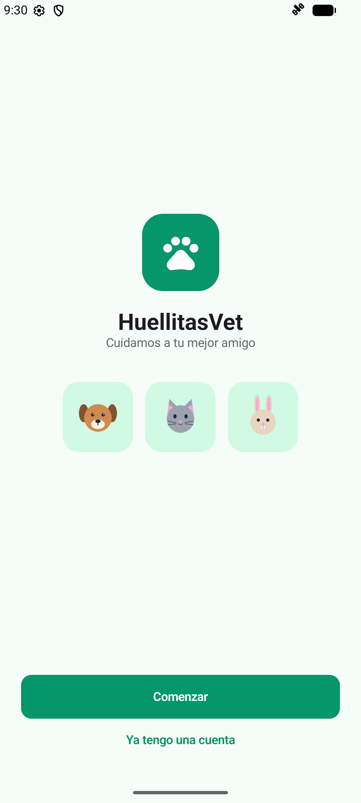 | 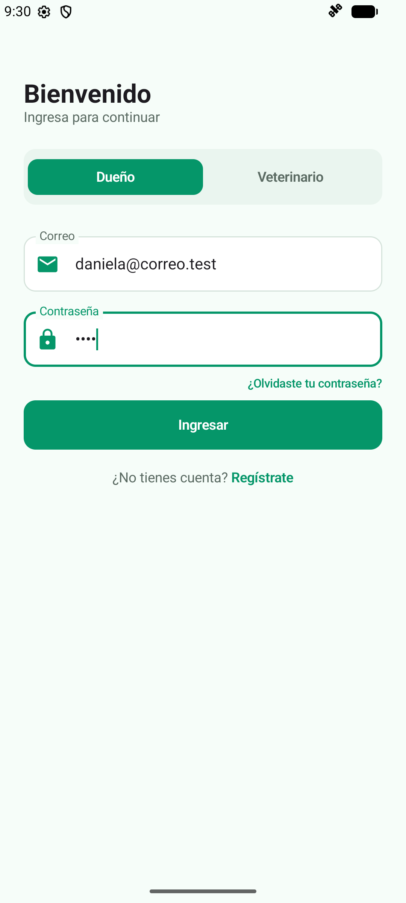 | 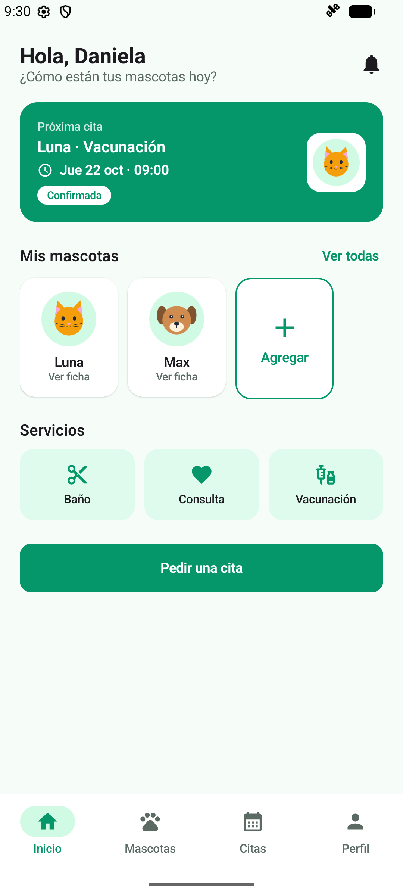 |

| 4. Mis mascotas | 5. Registrar mascota | 6. Ficha e historial clínico |
| :---: | :---: | :---: |
| 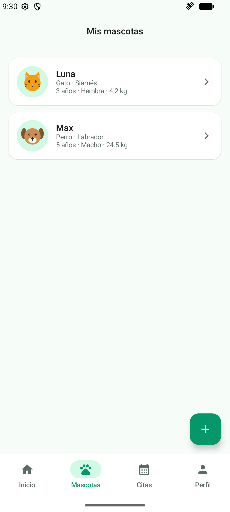 | 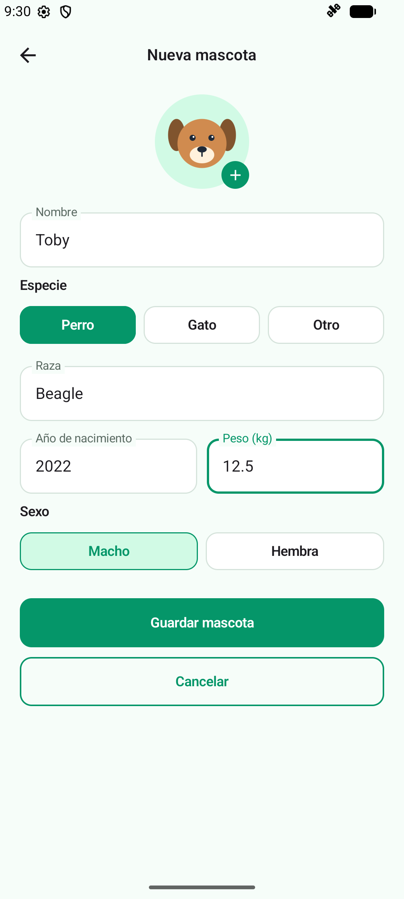 | 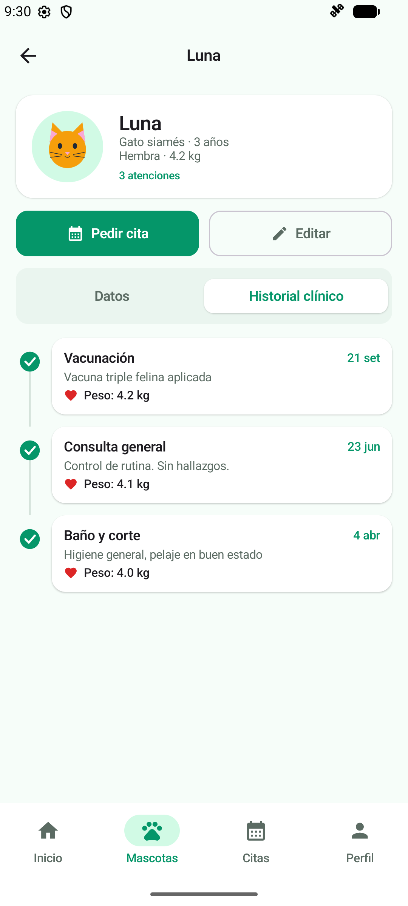 |

| 7. Pedir cita | 8. Mis citas | 9. Perfil y preferencias |
| :---: | :---: | :---: |
| 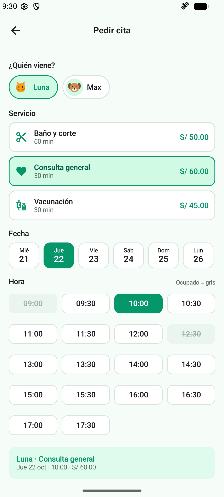 | 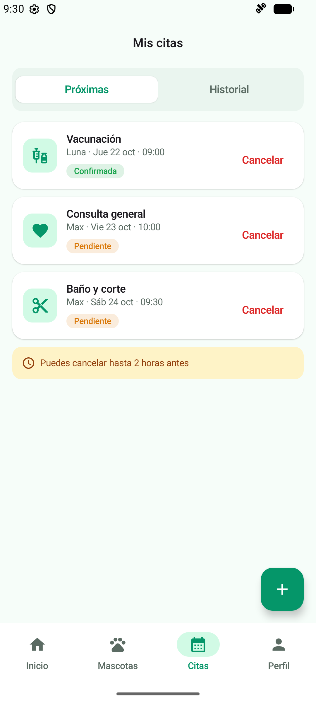 | 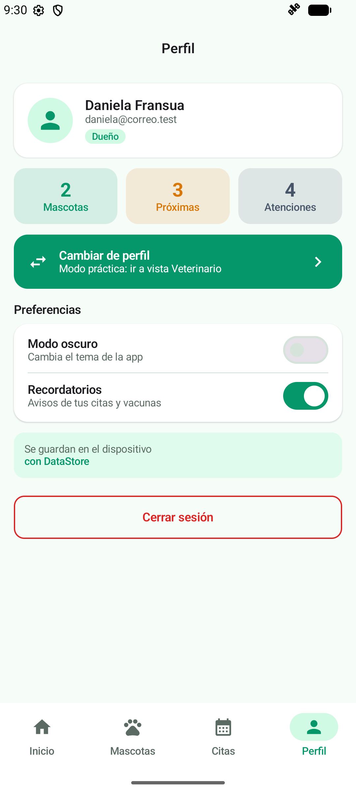 |

### Veterinario (8 vistas)

| 10. Inicio de sesión | 11. Panel de la clínica | 12. Agenda del día | 13. Atender cita |
| :---: | :---: | :---: | :---: |
| 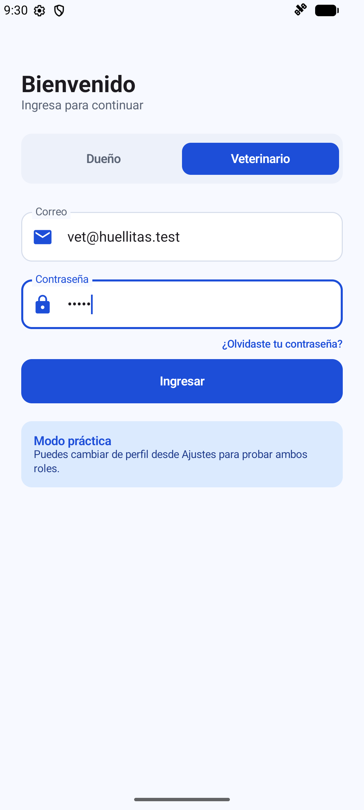 | 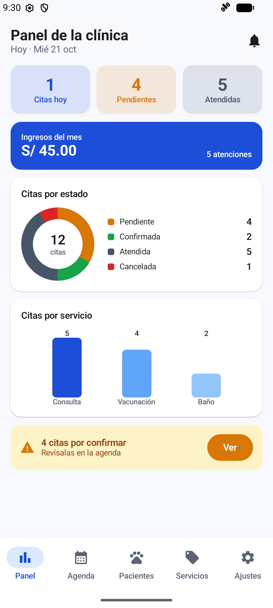 | 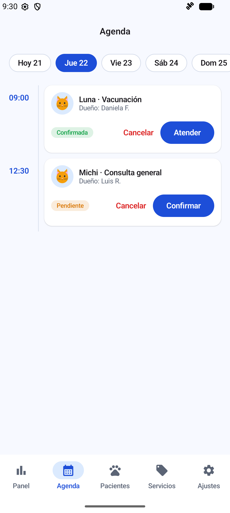 | 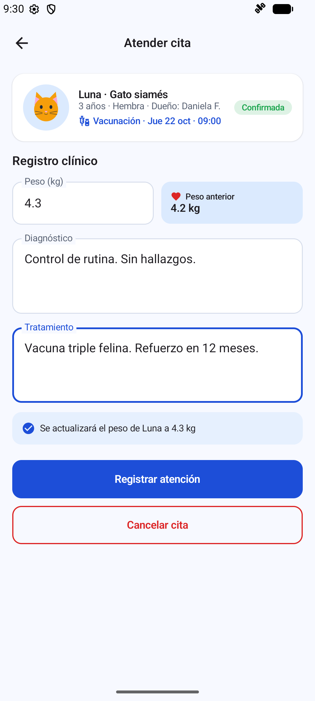 |

| 14. Pacientes | 15. Servicios | 16. Nuevo / editar servicio | 17. Ajustes (DataStore) |
| :---: | :---: | :---: | :---: |
| 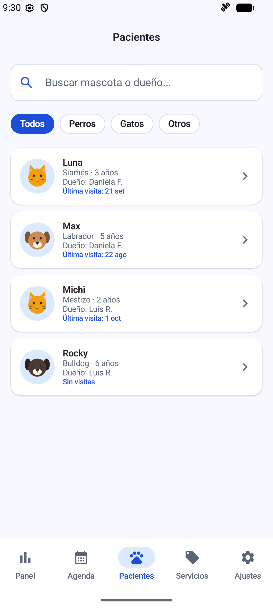 | 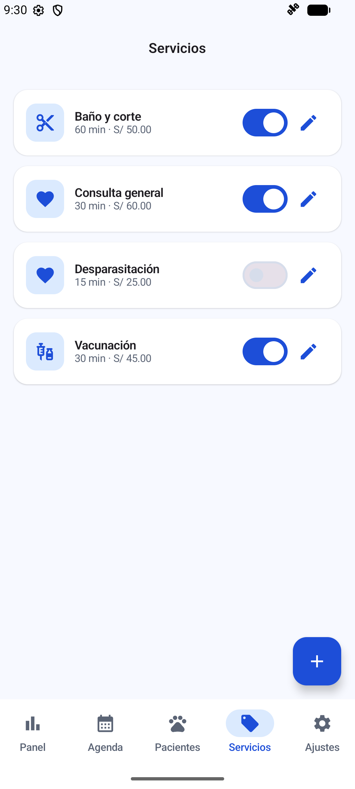 | 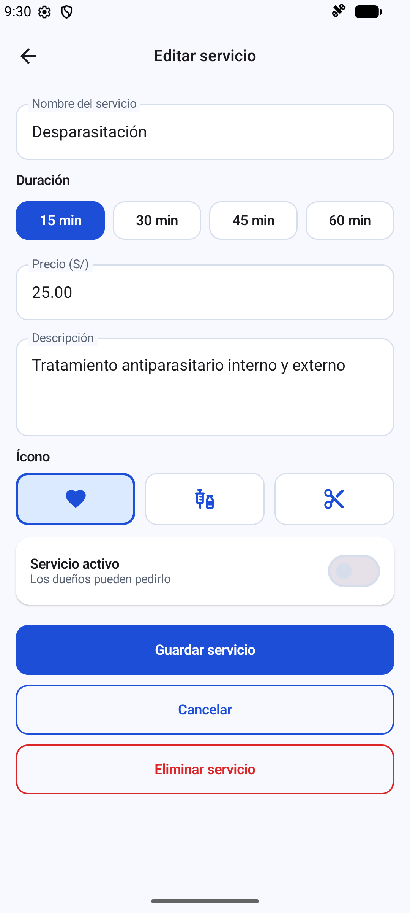 | 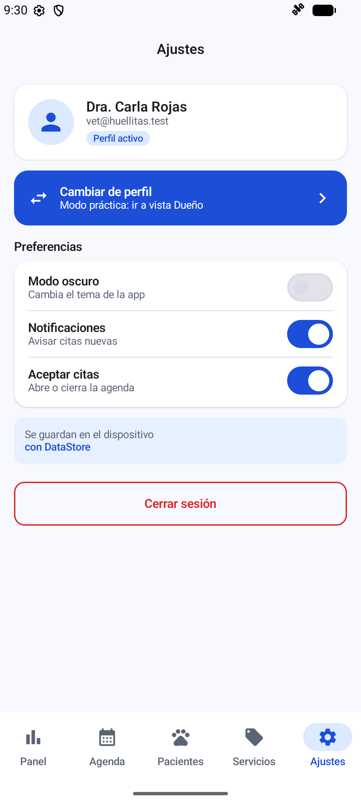 |

### Estados y reglas

| 18. Errores junto a cada campo | 19. Mascota con citas: no se elimina | 20. Modo oscuro |
| :---: | :---: | :---: |
| 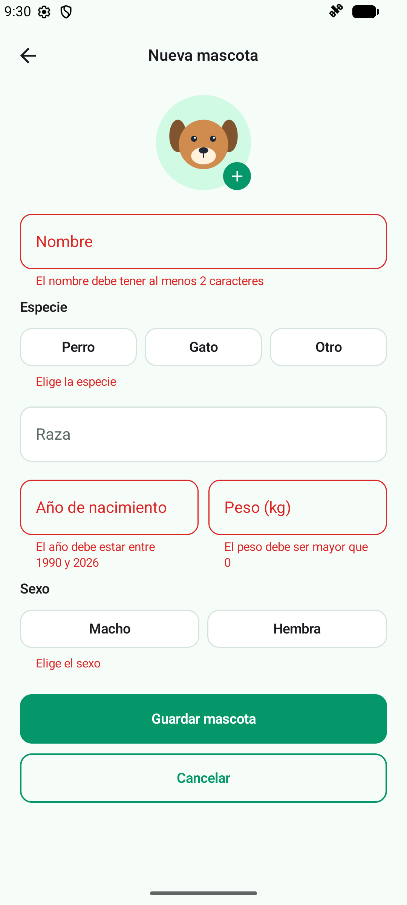 | 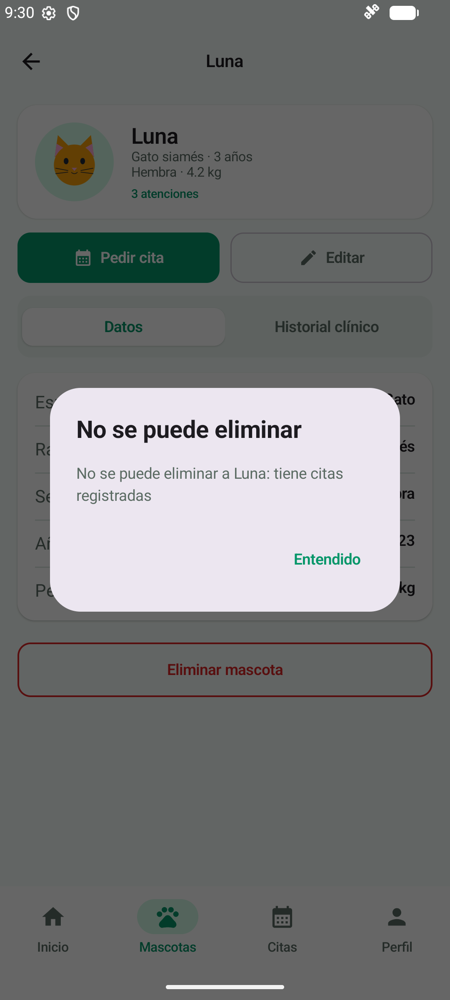 | 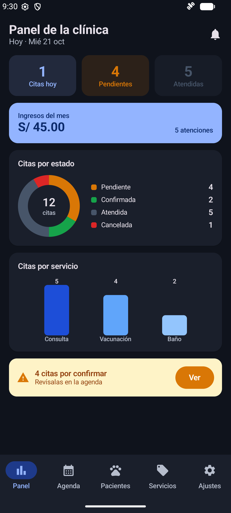 |

## Arquitectura MVVM + Repository

```text
┌────────────────────────────────────────────┐
│ VIEW (Composables en ui/)                  │
│ Solo observa estado y avisa eventos        │
└───────┬───────────────────────▲────────────┘
        │ eventos (clics)       │ collectAsStateWithLifecycle()
┌───────▼───────────────────────┴────────────┐
│ VIEWMODEL (StateFlow + reglas de negocio)  │◄──── PreferenciasStore (DataStore)
└───────┬───────────────────────▲────────────┘      perfil, modo oscuro, ajustes
        │ llama                 │ Flow / resultados
┌───────▼───────────────────────┴────────────┐
│ VetRepository (interface = contrato)       │
└───────┬────────────────────────────────────┘
        │ la implementa
┌───────▼────────────────────────────────────┐
│ VetRepositoryRoom → DAOs → SQLite          │
│ (huellitasvet.db)                          │
└────────────────────────────────────────────┘
```

| Capa | Conoce a | No debe |
|---|---|---|
| View (`ui/`) | Solo a su ViewModel | Usar DAO, Repository ni reglas de negocio |
| ViewModel (`viewmodel/`) | Solo al Repository (interface) y a las preferencias | Conocer Composables ni DAOs |
| Repository (`data/repository/`) | Los DAOs (en la implementación) | Conocer pantallas ni ViewModels |
| DAO / Room (`data/local/`) | SQL y entidades | Conocer ViewModels |

- Lectura que debe actualizar la pantalla → `Flow` (sin `suspend`). Escritura o acción única → `suspend`.
- Los ViewModels convierten el `Flow` del Repository en `StateFlow` con `stateIn(...)`.
- `VetViewModelFactory` recibe cómo crear cada ViewModel con su Repository y parámetros (por ejemplo, el id del dueño).
- Las operaciones que tocan dos tablas usan `db.withTransaction { }` (registrar atención y sembrar datos).

## Estructura de paquetes

```text
app/src/main/java/com/tecsup/huellitasvet/
├── MainActivity.kt
├── VetApp.kt                     → crea la base, el repository y las preferencias; siembra los datos
├── data/
│   ├── local/
│   │   ├── VetDatabase.kt        → @Database con 4 entidades (singleton "huellitasvet.db")
│   │   ├── DatosIniciales.kt     → datos de prueba ficticios
│   │   ├── entity/               → Servicio, Usuario, Mascota, Cita
│   │   ├── dao/                  → ServicioDao, UsuarioDao, MascotaDao, CitaDao
│   │   └── relation/             → MascotaConDueno, CitaConDetalle (relación anidada)
│   ├── repository/
│   │   ├── VetRepository.kt      → interface (el contrato)
│   │   └── VetRepositoryRoom.kt  → implementación con Room
│   └── prefs/
│       └── PreferenciasStore.kt  → DataStore (perfil, modo oscuro, notificaciones, aceptar citas)
├── model/                        → Rol, EstadoCita, Especie, Sexo, ConteoServicio, UltimaVisita, Horarios
├── viewmodel/                    → VetViewModelFactory, SesionViewModel, InicioViewModel, MascotaViewModel,
│                                   PedirCitaViewModel, MisCitasViewModel, PanelViewModel, AgendaViewModel,
│                                   AtenderCitaViewModel, PacientesViewModel, ServiciosViewModel
└── ui/
    ├── theme/                    → Color, Type, Theme (VetTheme según el rol, claro y oscuro)
    ├── components/               → AppTopBar, VetButton, VetTextField, EstadoCitaChip, MascotaAvatar (Canvas),
    │   │                           CitaCard, FechaChip, HoraChip, HistorialItem, Selectores, Preferencias, Formatos
    │   └── graficos/             → DatoGrafico, GraficoDona, GraficoBarras
    ├── navigation/               → Rutas, NavVet (grafo del dueño y del veterinario)
    ├── dueno/                    → Splash, Login, Inicio, Mascotas, FormularioMascota, FichaMascota,
    │                               PedirCita, MisCitas, Perfil
    └── veterinario/              → Panel, Agenda, AtenderCita, Pacientes, Servicios, FormularioServicio, Ajustes
```

## Base de datos

### 1. Modelo conceptual

- Un **usuario** tiene un rol: Dueño (CLIENTE) o Veterinario (ADMIN).
- Un **dueño** registra varias **mascotas**; cada mascota pertenece a un solo dueño.
- Una **mascota** tiene varias **citas**; cada cita es de una sola mascota.
- Un **servicio** se usa en varias **citas**; cada cita es de un solo servicio.
- La cita guarda la atención clínica (diagnóstico, tratamiento y peso registrado) cuando pasa a ATENDIDA.

Relación de dos niveles: usuario (dueño) → mascotas → citas.

### 2. Modelo entidad-relación (MER)

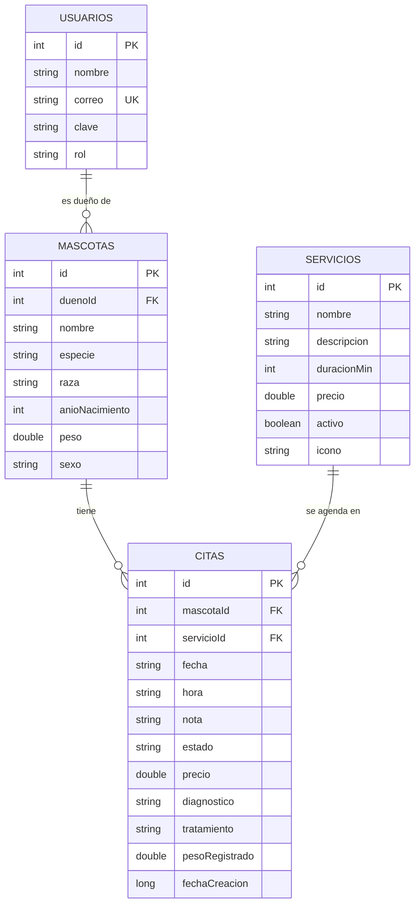

### 3. Modelo lógico

| Tabla | Columnas | Claves e índices |
|---|---|---|
| `usuarios` | id, nombre, correo, clave, rol (CLIENTE \| ADMIN) | PK `id` · índice único en `correo` |
| `servicios` | id, nombre, descripcion, duracionMin, precio, activo, icono (heart \| syringe \| scissors) | PK `id` |
| `mascotas` | id, duenoId, nombre, especie (PERRO \| GATO \| OTRO), raza, anioNacimiento, peso, sexo (MACHO \| HEMBRA) | PK `id` · FK `duenoId` → `usuarios.id` · índice en `duenoId` |
| `citas` | id, mascotaId, servicioId, fecha ('aaaa-MM-dd'), hora ('HH:mm'), nota, estado (PENDIENTE \| CONFIRMADA \| ATENDIDA \| CANCELADA), precio, diagnostico?, tratamiento?, pesoRegistrado?, fechaCreacion | PK `id` · FK `mascotaId` → `mascotas.id` · FK `servicioId` → `servicios.id` · índices en `mascotaId`, `servicioId` y (`fecha`, `hora`) |

Relaciones de lectura (Room `@Relation`):

- `MascotaConDueno` = `@Embedded Mascota` + `@Relation` al `Usuario` dueño.
- `CitaConDetalle` = `@Embedded Cita` + `@Relation(entity = Mascota::class)` a `MascotaConDueno` (relación anidada) + `@Relation` al `Servicio`.

### 4. Modelo físico (SQLite generado por Room, versión 1)

```sql
CREATE TABLE usuarios (
    id      INTEGER PRIMARY KEY AUTOINCREMENT NOT NULL,
    nombre  TEXT NOT NULL,
    correo  TEXT NOT NULL,
    clave   TEXT NOT NULL,
    rol     TEXT NOT NULL
);
CREATE UNIQUE INDEX index_usuarios_correo ON usuarios (correo);

CREATE TABLE servicios (
    id          INTEGER PRIMARY KEY AUTOINCREMENT NOT NULL,
    nombre      TEXT NOT NULL,
    descripcion TEXT NOT NULL,
    duracionMin INTEGER NOT NULL,
    precio      REAL NOT NULL,
    activo      INTEGER NOT NULL,   -- Boolean: 1 activo, 0 inactivo
    icono       TEXT NOT NULL
);

CREATE TABLE mascotas (
    id             INTEGER PRIMARY KEY AUTOINCREMENT NOT NULL,
    duenoId        INTEGER NOT NULL,
    nombre         TEXT NOT NULL,
    especie        TEXT NOT NULL,
    raza           TEXT NOT NULL,
    anioNacimiento INTEGER NOT NULL,
    peso           REAL NOT NULL,
    sexo           TEXT NOT NULL,
    FOREIGN KEY (duenoId) REFERENCES usuarios (id)
);
CREATE INDEX index_mascotas_duenoId ON mascotas (duenoId);

CREATE TABLE citas (
    id             INTEGER PRIMARY KEY AUTOINCREMENT NOT NULL,
    mascotaId      INTEGER NOT NULL,
    servicioId     INTEGER NOT NULL,
    fecha          TEXT NOT NULL,
    hora           TEXT NOT NULL,
    nota           TEXT NOT NULL,
    estado         TEXT NOT NULL,
    precio         REAL NOT NULL,
    diagnostico    TEXT,
    tratamiento    TEXT,
    pesoRegistrado REAL,
    fechaCreacion  INTEGER NOT NULL,
    FOREIGN KEY (mascotaId)  REFERENCES mascotas (id),
    FOREIGN KEY (servicioId) REFERENCES servicios (id)
);
CREATE INDEX index_citas_mascotaId  ON citas (mascotaId);
CREATE INDEX index_citas_servicioId ON citas (servicioId);
CREATE INDEX index_citas_fecha_hora ON citas (fecha, hora);
```

Consultas destacadas del `CitaDao`:

- Citas de un dueño: `SELECT c.* FROM citas c INNER JOIN mascotas m ON c.mascotaId = m.id WHERE m.duenoId = :duenoId ORDER BY c.fecha, c.hora`
- Horas ocupadas de un día: `SELECT hora FROM citas WHERE fecha = :fecha AND estado != 'CANCELADA'`
- Citas por servicio (panel): `JOIN` con `servicios` y `GROUP BY s.id`
- Ingresos del mes: `SELECT COALESCE(SUM(precio), 0.0) FROM citas WHERE estado = 'ATENDIDA' AND fecha >= :fechaInicio`

## Reglas de negocio y dónde viven

Todas las reglas viven en los ViewModels; las pantallas solo muestran el resultado y los DAOs solo ejecutan SQL.

| Regla | Detalle | Dónde vive |
|---|---|---|
| Visibilidad | El dueño solo ve sus mascotas y las citas de sus mascotas; el veterinario ve todo | `InicioViewModel`, `MisCitasViewModel`, `PedirCitaViewModel` (filtran por el id del dueño) |
| Login | Campos vacíos, credenciales incorrectas y rol distinto a la pestaña elegida muestran error | `SesionViewModel.login` |
| Registrar mascota | Nombre de al menos 2 caracteres, especie y sexo elegidos, año entre 1990 y el actual, peso mayor que 0; errores junto a cada campo | `MascotaViewModel.guardar` |
| Eliminar mascota | Solo si no tiene citas; si tiene, se muestra un mensaje y no se borra | `MascotaViewModel.eliminar` |
| Pedir cita | Mascota del dueño, servicio activo, fecha de hoy a 7 días, horarios de 09:00 a 17:30 cada 30 min; si es hoy, solo horas futuras; estado inicial PENDIENTE y precio copiado del servicio | `PedirCitaViewModel.confirmar` y `VetRepositoryRoom.crearCita` |
| Horario único | Una cita no cancelada por fecha y hora; el horario ocupado sale gris y se vuelve a consultar antes de crear | `PedirCitaViewModel` (`horasNoDisponibles` y `confirmar`) |
| Cancelar (dueño) | Solo PENDIENTE o CONFIRMADA y si faltan más de 2 horas (`Duration.between`) | `MisCitasViewModel.puedeCancelar` y `cancelar` |
| Estados (veterinario) | PENDIENTE → CONFIRMADA; desde PENDIENTE o CONFIRMADA → CANCELADA; ATENDIDA y CANCELADA son finales | `AgendaViewModel.confirmar` y `cancelar`, `AtenderCitaViewModel` |
| Registrar atención | Diagnóstico de al menos 5 caracteres y peso mayor que 0; en una transacción la cita pasa a ATENDIDA y se actualiza el peso de la mascota | `AtenderCitaViewModel.registrar` + `VetRepositoryRoom.registrarAtencion` (`withTransaction`) |
| Historial clínico | Citas ATENDIDAS de la mascota, la más reciente primero | `MascotaViewModel.historial` (consulta `observarHistorial`) |
| Panel | Citas de hoy sin canceladas, pendientes, atendidas, ingresos del mes desde el día 1 y alerta de citas por confirmar | `PanelViewModel` |
| Servicios | Nombre obligatorio, duración 15/30/45/60, precio mayor que 0; un servicio con citas no se elimina (solo se desactiva); un servicio inactivo no aparece al pedir cita | `ServiciosViewModel.guardar` y `eliminar`, `PedirCitaViewModel` (solo activos) |
| Aceptar citas | Si el veterinario lo apaga, el dueño ve "La clínica no está recibiendo citas" y no puede confirmar | `PedirCitaViewModel` (lee la preferencia de DataStore) |
| Cambiar de perfil | Guarda el otro perfil y navega a su grafo limpiando la pila (`popUpTo`) | `SesionViewModel.cambiarPerfil` + `NavVet` |
| Persistencia | El perfil activo y el modo oscuro se conservan al cerrar y abrir la app | `PreferenciasStore` (DataStore) + `SesionViewModel` |

## Pruebas de aceptación

Probadas en el emulador Medium Phone (API 37).

| Prueba | Resultado esperado | Estado |
|---|---|---|
| Login con clave incorrecta | Mensaje de error, no entra | Cumple |
| Dueño: registrar mascota sin nombre | Errores junto a cada campo, no se guarda | Cumple |
| Dueño: eliminar una mascota con citas | Mensaje de aviso y no se elimina | Cumple |
| Dueño: pedir cita | Aparece en Mis citas como PENDIENTE y con el precio del servicio | Cumple |
| Dueño: elegir un horario ocupado | El horario aparece gris y no se puede elegir | Cumple |
| Veterinario: agenda | La cita aparece en su hora y puede confirmarla; el dueño la ve CONFIRMADA | Cumple |
| Veterinario: atender una cita | Pasa a ATENDIDA, el dueño la ve en el historial y el peso de la mascota se actualizó | Cumple |
| Dueño: cancelar una cita a menos de 2 horas | No se permite cancelar | Cumple |
| Veterinario: ingresos del mes | Coinciden con la suma del precio de las citas atendidas | Cumple |
| Veterinario: desactivar un servicio | Ya no se puede elegir al pedir una cita | Cumple |
| Veterinario: eliminar un servicio con citas | No se elimina; se muestra un mensaje | Cumple |
| Cerrar y abrir la app | Las citas siguen ahí y el perfil y el modo oscuro se recuerdan | Cumple |

## Para pensar

### ¿Por qué fecha y hora son texto?

Guardé la fecha como "aaaa-MM-dd" y la hora como "HH:mm" porque así el texto se ordena igual que las fechas reales, y se puede comparar directo en SQL con = o >=, por ejemplo para buscar las horas ocupadas de un día o los ingresos desde el día 1. Cuando necesito calcular, como en la regla de las 2 horas, lo convierto con LocalDate.parse y LocalTime.parse. Así no tuve que escribir convertidores de tipos para Room y pude enfocarme en las consultas.

### ¿Por qué guardar el precio en la cita?

El precio de la cita es una foto del momento en que se pidió. Si después la clínica sube el precio de un servicio, las citas que ya existían mantienen lo que costaron, y los ingresos del mes del panel no cambian solos. Si leyera el precio desde la tabla de servicios, cualquier cambio alteraría el historial.

### ¿Esta función cambia datos una sola vez o debe avisar cuando cambian?

Esa pregunta me ayudó a decidir el tipo de cada función. Si solo hace una acción, como guardar una mascota, crear una cita o registrar una atención, es suspend. Si la pantalla necesita enterarse cada vez que cambian los datos, como la lista de citas, el historial o los contadores del panel, devuelve un Flow sin suspend. Por eso, cuando el veterinario confirma una cita, el dueño la ve confirmada sin recargar nada.
