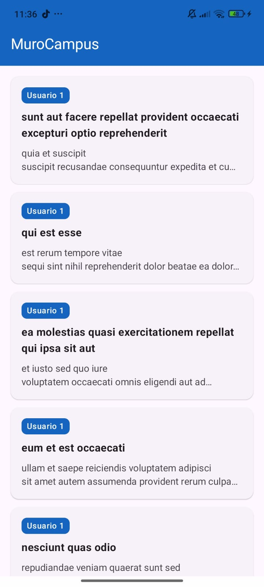
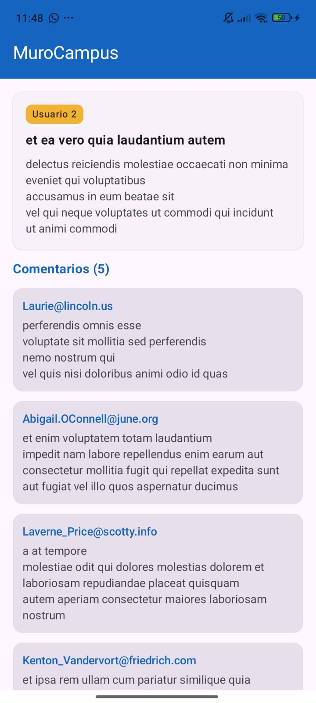
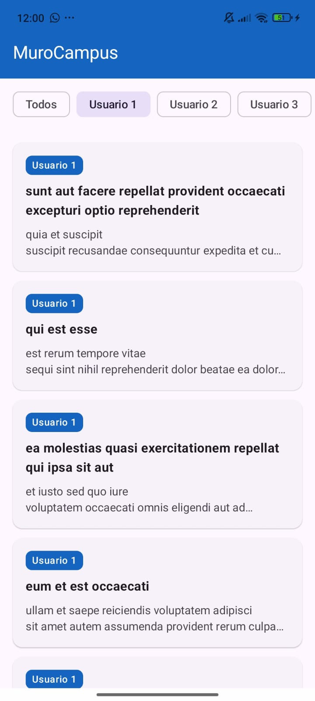
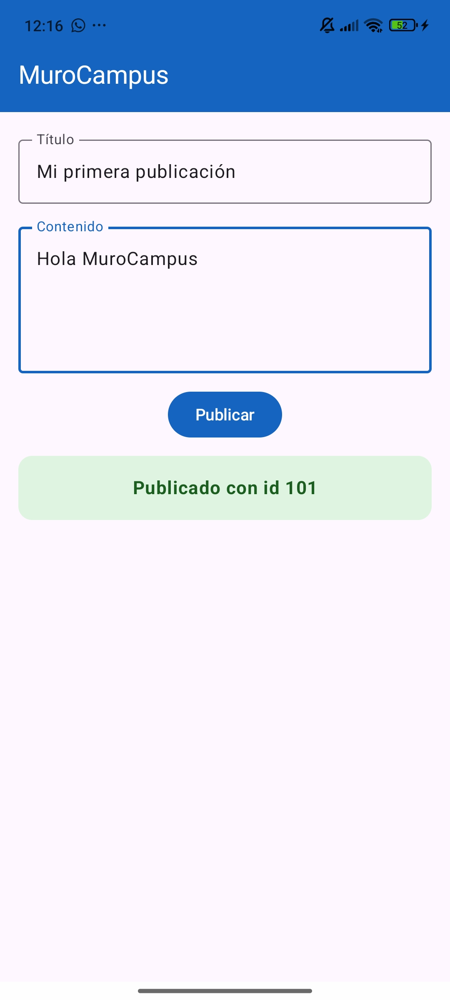
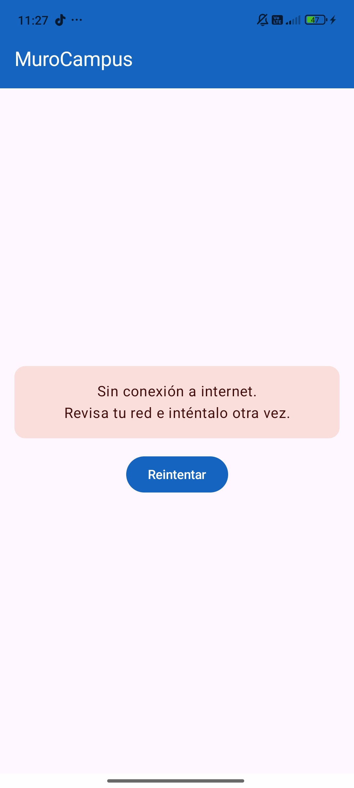
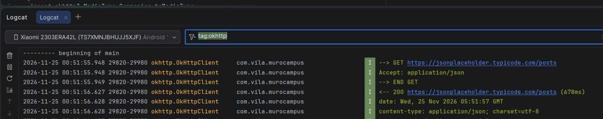
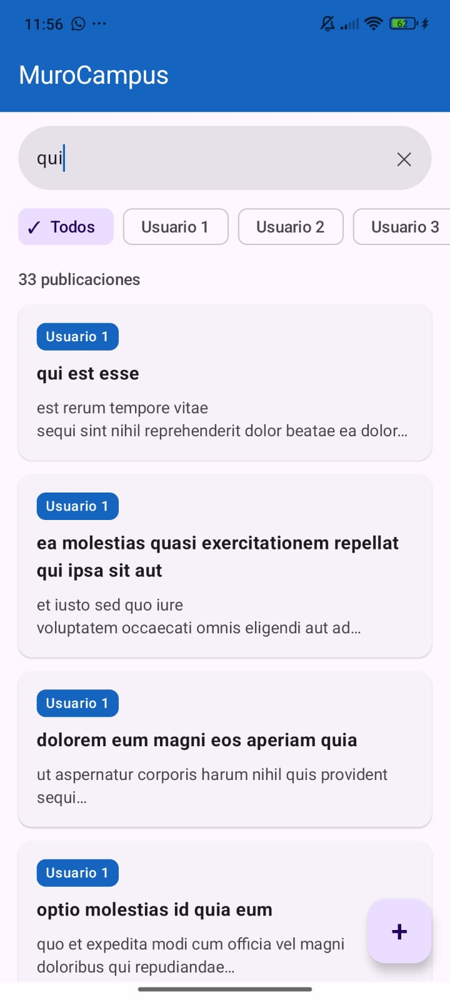
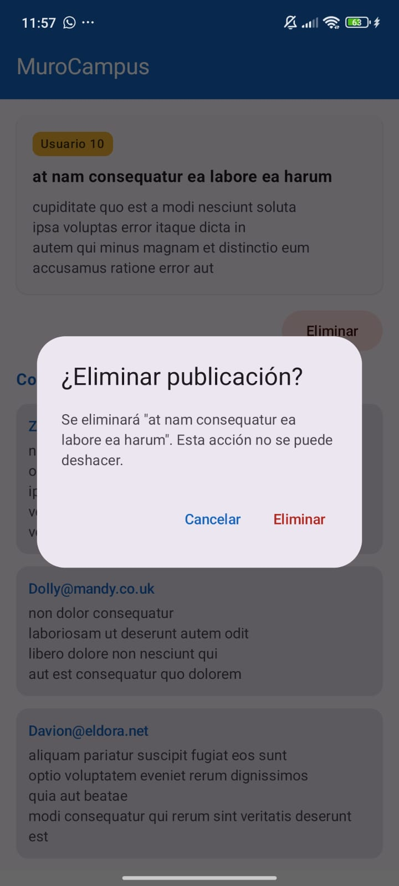
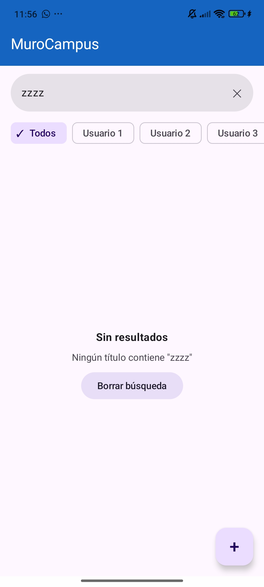
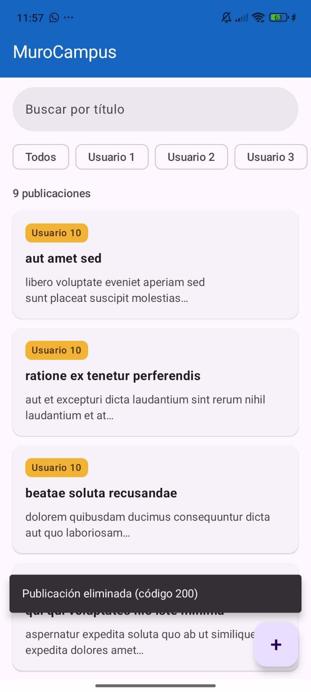

# MuroCampus

**Alumna:** Daniela Fransua Vila Ramos

**Curso:** Programación en Móviles · Tecsup

**Laboratorio:** Semana 09 · Consumo de API REST con Retrofit

**Rama:** sin-ia (Fase 1) · con-ia (Fase 2)

## Descripción

MuroCampus es un muro de publicaciones que consume la API pública
[JSONPlaceholder](https://jsonplaceholder.typicode.com/). La app permite:

- Ver la lista de publicaciones (`GET posts`).
- Abrir una publicación con sus comentarios (`GET posts/{id}` y `GET posts/{id}/comments`).
- Filtrar las publicaciones por usuario (`GET posts?userId=N`).
- Crear una publicación nueva (`POST posts` con `@Body`).
- Mostrar mensajes claros cuando no hay internet, cuando el servidor responde con error o cuando el JSON no coincide, sin que la app se cierre.

## Tecnologías

| Tecnología | Para qué se usa |
| --- | --- |
| Kotlin + Jetpack Compose | Interfaz de usuario |
| Material 3 | Componentes y tema de colores |
| Retrofit 2.11 | Cliente REST: define las llamadas con anotaciones |
| OkHttp + HttpLoggingInterceptor | Conexión HTTP y registro de peticiones en Logcat |
| kotlinx.serialization | Convierte el JSON en clases de Kotlin |
| ViewModel + StateFlow | Guarda el estado de cada pantalla |
| Corrutinas | Llamadas a la red sin bloquear la pantalla |

## Estructura de paquetes

```
app/src/main/java/com/vila/murocampus/
├── MainActivity.kt              Scaffold, barra superior, botón + y navegación
├── model/
│   └── Modelos.kt               Post, Comentario y NuevoPost (@Serializable)
├── data/
│   ├── PostRepository.kt        Interface + PostRepositoryRemote (devuelve Result)
│   └── remote/
│       ├── PostApi.kt           Endpoints con @GET, @POST, @Path, @Query y @Body
│       └── RetrofitClient.kt    Retrofit + OkHttp + conversor JSON
├── viewmodel/
│   ├── UiState.kt               Cargando / Exito / Error y mensajeDe()
│   ├── PostsViewModel.kt        Lista, filtro, detalle y crear
│   └── PostsViewModelFactory.kt Crea el ViewModel con el Repository
└── ui/
    ├── Componentes.kt           TarjetaPost, Cargando y ErrorConReintento
    ├── PantallaLista.kt         Lista con chips de filtro por usuario
    ├── PantallaDetalle.kt       Publicación completa y comentarios
    ├── PantallaCrear.kt         Formulario para publicar
    └── theme/                   Color.kt, Theme.kt y Type.kt
```

## Arquitectura MVVM + Repository

```
┌──────────────────────────────┐
│  UI (Compose)                │  PantallaLista, PantallaDetalle, PantallaCrear
│  observa StateFlow           │
└──────────────┬───────────────┘
               │ eventos: cargar(), filtrar(), abrir(), publicar()
               ▼
┌──────────────────────────────┐
│  PostsViewModel              │  UiState: Cargando / Exito / Error
│  viewModelScope              │
└──────────────┬───────────────┘
               │ suspend fun ... : Result<T>
               ▼
┌──────────────────────────────┐
│  PostRepository              │  try/catch → Result.success / Result.failure
└──────────────┬───────────────┘
               │
               ▼
┌──────────────────────────────┐
│  PostApi (Retrofit + OkHttp) │  GET / POST en JSON
└──────────────┬───────────────┘
               ▼
     jsonplaceholder.typicode.com
```

Cada capa solo conoce a la de abajo. El ViewModel no sabe nada de Retrofit: solo recibe un `Result` del Repository.

## Capturas

| Lista | Detalle | Filtro |
| --- | --- | --- |
|  |  |  |

| Crear | Error de conexión |
| --- | --- |
|  |  |

## Pruebas de error

| Prueba | Cómo se provocó | Resultado | OK |
| --- | --- | --- | --- |
| Sin internet | Modo avión al abrir la app | Sin conexión a internet + botón Reintentar | Sí |
| Reintentar | Quitar modo avión y pulsar Reintentar | Carga la lista | Sí |
| Recurso inexistente | Abrir `posts/9999` (temporal) | Error del servidor (404) | Sí |
| JSON inesperado | Agregar a Post un campo que no llega (temporal) | Respuesta inesperada | Sí |
| Cancelación | Abrir el detalle y volver rápido | La app no se cierra | Sí |
| Detalle | Abrir varias publicaciones | Siempre 5 comentarios | Sí |
| Filtro | Elegir cada usuario | Siempre 10 publicaciones | Sí |
| Crear | Enviar una publicación | Publicado con id 101 | Sí |
| Código | Revisar PostsViewModel | Sin Retrofit, PostApi ni HttpException | Sí |

## Para pensar

**1. ¿Qué diferencia hay entre GET y POST? ¿Por qué crear lleva @Body y porUsuario lleva @Query?**
GET solo pide datos y no cambia nada en el servidor. POST envía datos para crear algo nuevo. `crear` lleva `@Body` porque el `NuevoPost` completo viaja en el cuerpo de la petición como JSON. `porUsuario` lleva `@Query` porque el `userId` solo es un filtro que va en la URL (`posts?userId=3`), y un GET no tiene cuerpo.

**2. ¿Por qué la ruta es "posts" y no "/posts"?**
La base URL termina en `/` y Retrofit le pega la ruta relativa: `https://jsonplaceholder.typicode.com/` + `posts`. Si la ruta empieza con `/`, Retrofit la toma desde la raíz del dominio y borra cualquier parte extra de la base URL. Por ejemplo, con una base `.../api/v1/`, la ruta `/posts` quedaría en `.../posts` y se perdería el `api/v1`. Por eso la regla es: base con `/` al final y rutas sin `/` al inicio.

**3. ¿Por qué el Repository devuelve Result en vez de dejar que la excepción llegue al ViewModel?**
`Result` convierte el error en un valor normal. Así el ViewModel no necesita `try/catch` ni conocer las excepciones de Retrofit u OkHttp: solo usa `onSuccess` y `onFailure`. Cada capa queda separada y la app nunca se cierra por una excepción sin atrapar. La única excepción que no se atrapa es `CancellationException`: se vuelve a lanzar para que la cancelación de corrutinas siga funcionando.

**4. ¿Qué pasa si olvidas el permiso INTERNET? ¿Y si olvidas ignoreUnknownKeys y el servidor agrega un campo nuevo?**
Sin el permiso `INTERNET`, Android bloquea la conexión y ninguna llamada llega al servidor: la app siempre muestra un error en vez de la lista. Sin `ignoreUnknownKeys`, si el servidor agrega un campo que `Post` no tiene, kotlinx.serialization lanza una `SerializationException` y la lista entera falla con *Respuesta inesperada*, aunque los datos que sí usamos estén bien. Con `ignoreUnknownKeys = true`, los campos extra simplemente se ignoran.

**5. ¿Por qué la pantalla de lista usa un when sobre UiState y no un if con tres variables?**
`UiState` es una `sealed interface`: la pantalla está en un solo estado a la vez (Cargando, Éxito o Error). Con tres variables separadas (`cargando`, `error`, `datos`) podrían darse combinaciones imposibles, como estar cargando y con error al mismo tiempo. Además, el `when` es exhaustivo: el compilador obliga a manejar los tres casos, así que no se puede olvidar ninguno.

**6. JSONPlaceholder no guarda los POST. ¿Cómo cambiaría tu app si usaras un servicio real?**
El servidor guardaría la publicación y devolvería su id real. Después de publicar, habría que actualizar la lista: volver a llamar `cargar()` o agregar el `Post` que devuelve el servidor. El `userId` ya no sería fijo (`1`), sino el del usuario que inició sesión, y cada petición llevaría un token de autenticación en un header, por ejemplo con un interceptor de OkHttp. También habría que manejar errores nuevos, como 400 (datos inválidos) o 401 (sin sesión).

---

# Fase 2 · Mejoras con IA

**Rama:** con-ia

Sobre la app de la Fase 1 se hicieron 3 mejoras con ayuda de IA, sin romper la arquitectura MVVM + Repository. Los prompts usados, lo que respondió la IA y lo que se corrigió están en [PROMPTS.md](PROMPTS.md).

| N | Mejora | Capas que cambian | Commit |
| --- | --- | --- | --- |
| 1 | Encabezado con interceptor | RetrofitClient | `feat(red): agrega interceptor con encabezado Accept` |
| 2 | Búsqueda por título | ViewModel + View | `feat(busqueda): filtra publicaciones por titulo` |
| 3 | Borrar publicación | API + Repository + ViewModel + View | `feat(borrar): elimina publicacion con DELETE y Response` |

## Capturas de la Fase 2

| Mejora 1 · Interceptor | Mejora 2 · Búsqueda | Mejora 3 · Borrar |
| --- | --- | --- |
|  |  |  |
| `Accept: application/json` en Logcat | Búsqueda "qui" con contador (33 publicaciones) | Confirmación antes de borrar |
| |  |  |
| | Sin resultados + Borrar búsqueda | Aviso "Publicación eliminada (código 200)" y la lista con 9 publicaciones |

## Mejora 1 · Interceptor con encabezado Accept

Un `Interceptor` de OkHttp agrega `Accept: application/json` a **todas** las peticiones, sin repetirlo en cada endpoint de `PostApi`. Se registra **antes** del `HttpLoggingInterceptor`; si fuera al revés, el log mostraría la petición sin el encabezado. No cambia nada visible en la app: se comprueba en Logcat.

## Mejora 2 · Búsqueda por título

Una barra de búsqueda con estilo Material 3 filtra por título las publicaciones **ya descargadas**, sin hacer nuevas peticiones a la API. El filtro vive en el ViewModel: `combine(_lista, _busqueda)` produce `listaVisible`, y la pantalla solo la dibuja. La búsqueda funciona junto con el filtro por usuario y no distingue mayúsculas. Arriba de la lista muestra un contador, y si no encuentra nada, el estado *Sin resultados* con el botón **Borrar búsqueda**.

## Mejora 3 · Borrar publicación con DELETE

El detalle tiene un botón **Eliminar** que pide confirmación con un `AlertDialog`. La API declara `@DELETE("posts/{id}")` y devuelve `Response<Unit>`. El **Repository** revisa `isSuccessful`: si el código no es 2xx, lanza `HttpException`, y `llamar{}` lo convierte en `Result.failure`. Así el ViewModel sigue sin conocer Retrofit. Si sale bien, la app vuelve a la lista y muestra el aviso *Publicación eliminada (código 200)*. Como JSONPlaceholder no borra de verdad, el ViewModel quita la publicación de la lista local.

## Pruebas de la Fase 2

| Prueba | Cómo se hizo | Resultado | OK |
| --- | --- | --- | --- |
| Encabezado | Logcat con `tag:okhttp` | `Accept: application/json` en GET, POST y DELETE | Sí |
| Buscar | Escribir "qui" | Solo títulos con "qui" | Sí |
| Sin resultados | Escribir "zzz" | Sin resultados + Borrar búsqueda | Sí |
| Búsqueda local | Escribir y mirar Logcat | No hay peticiones nuevas | Sí |
| Búsqueda + filtro | Usuario 2 y escribir "et" | Solo publicaciones del usuario 2 con "et" | Sí |
| Cancelar borrado | Eliminar y luego Cancelar | No se borra nada | Sí |
| Borrar | Eliminar y confirmar | DELETE 200, vuelve a la lista sin esa publicación | Sí |
| Borrar sin internet | Modo avión y Eliminar | No se pudo eliminar + mensaje, se queda en el detalle | Sí |
| Código | Revisar PostsViewModel | Sin Retrofit, PostApi, Response ni HttpException | Sí |