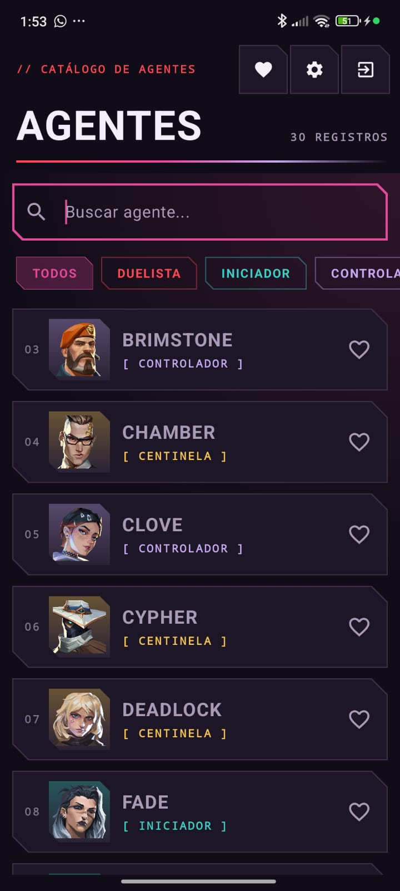
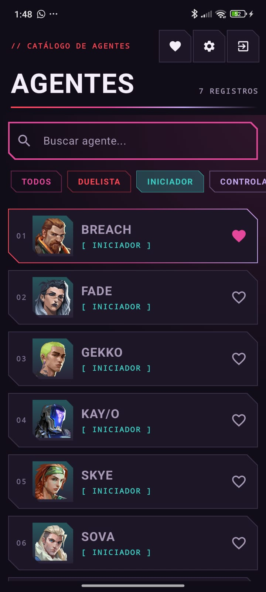
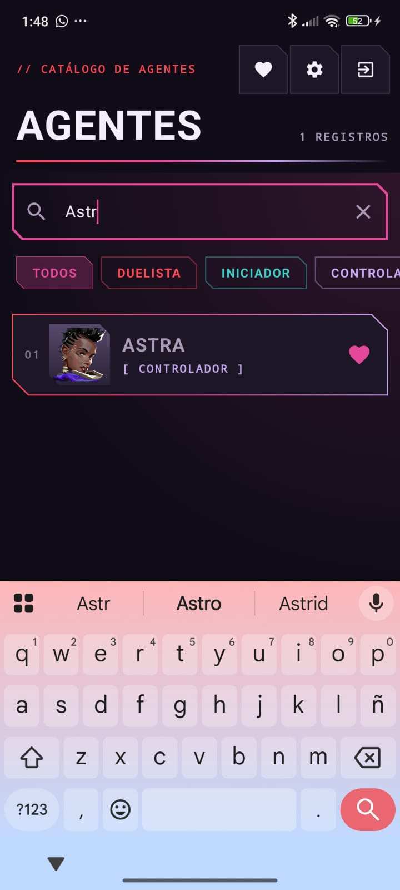
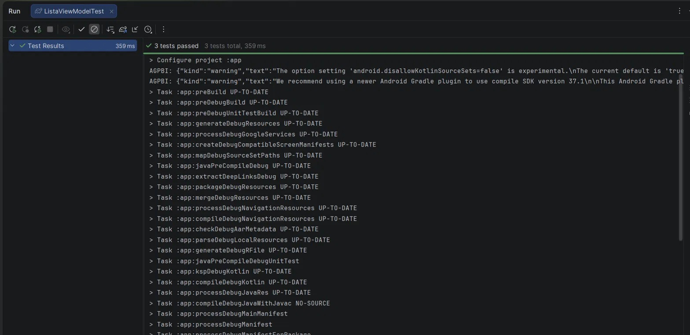

# Valorant · Fase 2 (con IA)

Rama **`con-ia`** del Laboratorio 11-12 de Programación en Móviles (Tecsup).
Parte del proyecto terminado en la rama **`sin-ia`** (Fase 1) y agrega dos mejoras hechas con apoyo de IA.
Cada consulta a la IA está documentada en [`PROMPTS.md`](PROMPTS.md).

- **Integrantes:** Daniela Fransua Vila Ramos · Karla Estefany CL
- **API:** https://valorant-api.com

## Mejora 1 · Filtro por rol y buscador por nombre
- **Filtro por rol:** chips para ver solo Duelistas, Iniciadores, Controladores o Centinelas. El chip **TODOS** quita el filtro.
- **Buscador por nombre:** al escribir, la lista muestra solo los agentes cuyo nombre contiene el texto, sin importar mayúsculas. El botón ✕ borra la búsqueda.
- Los dos se pueden usar juntos (por ejemplo, buscar dentro de los Centinelas).
- La lógica está en el `ListaViewModel`: con `combine` se junta la lista de Room con el rol elegido y el texto de búsqueda. La pantalla solo muestra lo que recibe (MVVM).
- Componentes nuevos: `ui/components/FiltroRoles.kt` y `ui/components/Buscador.kt`.

| Todos los agentes | Filtrado por rol | Búsqueda por nombre |
|---|---|---|
|  |  |  |

## Mejora 2 · Pruebas unitarias del ViewModel (R12)
Archivo: `app/src/test/java/com/tecsup/valorant/ListaViewModelTest.kt`

Se usan un **repositorio falso** y un **notificador falso**, así que las pruebas corren sin internet ni Room. Esto es posible porque `ItemRepository` es una *interface*.

| Prueba | Qué comprueba |
|---|---|
| `conInternet_muestraLaListaYNotifica` | Con internet, muestra la lista y lanza la notificación |
| `sinInternetYSinDatos_muestraError` | Sin internet y sin datos, muestra el error |
| `sinInternetConDatosGuardados_muestraDatosYAviso` | Sin internet con datos guardados, muestra la lista y el aviso |

## Reparto de la Fase 2
| Daniela | Karla Estefany CL |
|---|---|
| Pruebas unitarias del ViewModel, README de la rama | Filtro por rol y buscador por nombre |

---
> Valorant y sus imágenes pertenecen a Riot Games. Proyecto académico sin fines comerciales.