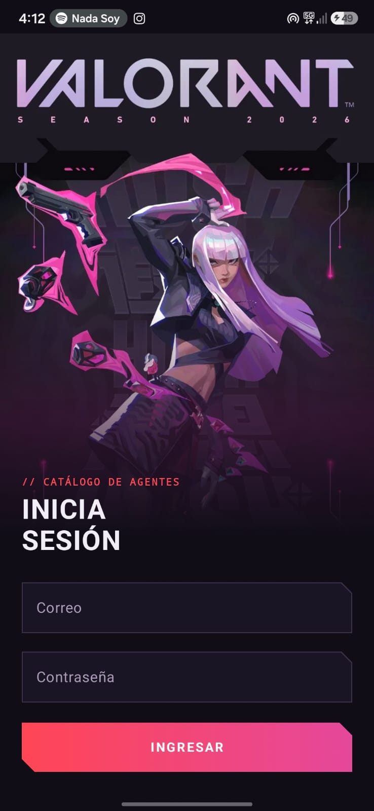
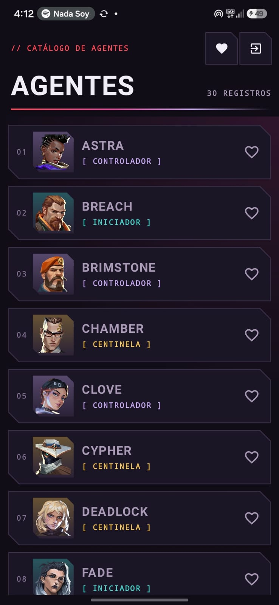
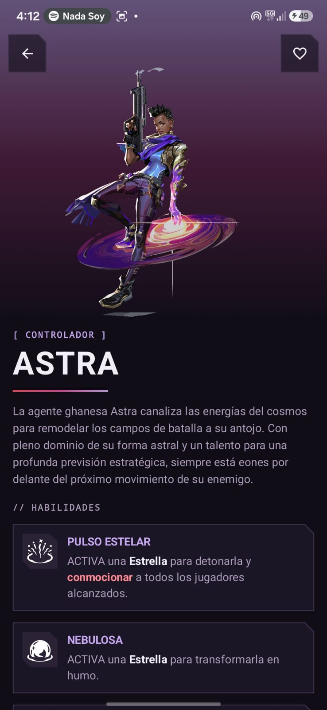
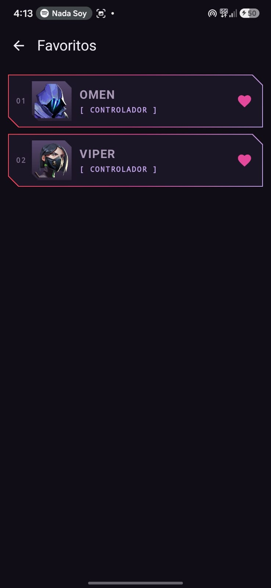
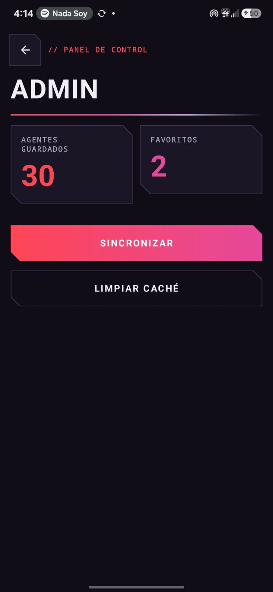
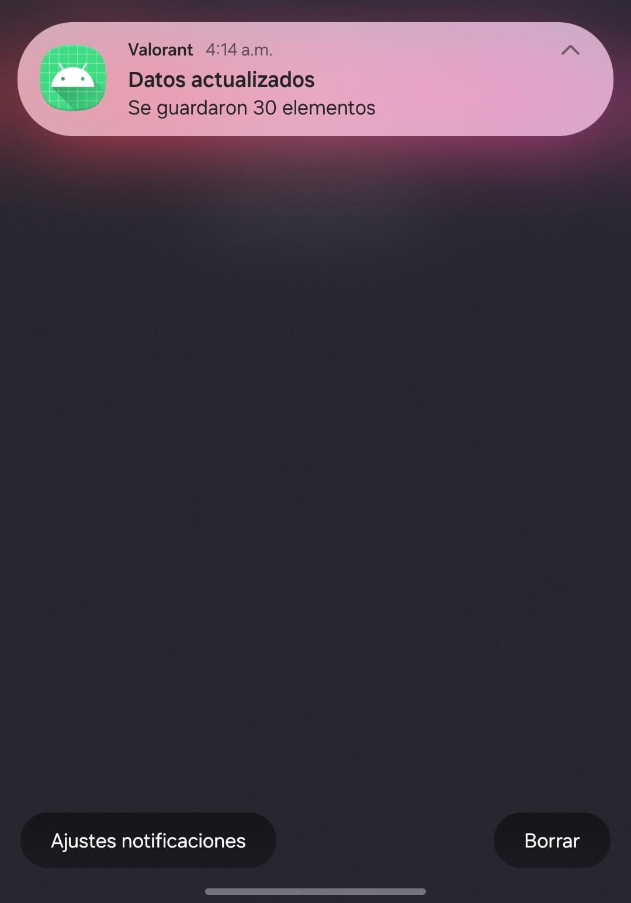

# Valorant · Agentes

App Android del Laboratorio 11-12 de Programación en Móviles (Tecsup).

- **Integrantes:** Daniela Vila Ramos · Karla Estefany CL
- **Tema:** Personajes de videojuegos · Valorant (agentes jugables)
- **API:** https://valorant-api.com
  - Lista: `/v1/agents?isPlayableCharacter=true&language=es-MX`
  - Detalle: `/v1/agents/{uuid}?language=es-MX`

## Tecnologías
Jetpack Compose + Material 3 · MVVM · Retrofit · Room · Firebase Auth + Firestore · Notificaciones locales

## Cómo compilar
1. Clonar el repositorio y abrirlo en Android Studio.
2. Crear un proyecto en Firebase con el paquete `com.tecsup.valorant`.
3. Descargar `google-services.json` y colocarlo en `app/` (no está en el repo por seguridad).
4. Sync de Gradle y ejecutar en un emulador con Google Play.

## Usuarios de prueba
1. Firebase → Authentication → crear `admin@...` y `usuario@...` con correo y contraseña.
2. Firestore → colección `usuarios` → un documento por usuario cuyo ID es el UID, con los campos `rol` (`admin` o `usuario`) y `nombre`.

## Capturas

<table>
  <tr>
    <td align="center"><b>Login</b>  </td>
    <td align="center"><b>Lista de agentes</b>  </td>
    <td align="center"><b>Detalle y habilidades</b>  </td>
  </tr>
  <tr>
    <td align="center"><b>Favoritos</b>  </td>
    <td align="center"><b>Panel Admin</b>  </td>
    <td align="center"><b>Notificación</b>  </td>
  </tr>
</table>

## Reparto de tareas
| Daniela | Karla Estefany CL |
|---|---|
| Proyecto base, contratos, Retrofit, repositorio, detalle, modo sin conexión, login, notificación | Dependencias, componentes y lista, Room, ViewModel de la lista, favoritos, Firebase, panel Admin, README |
