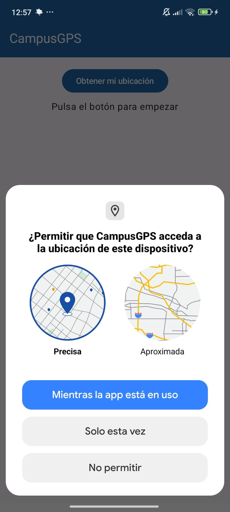
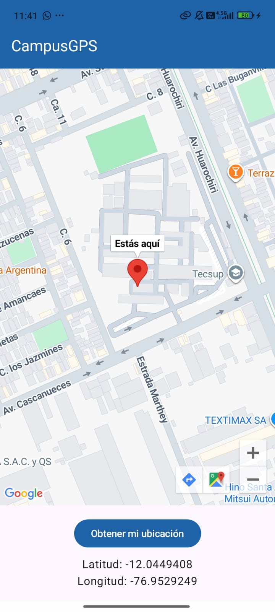
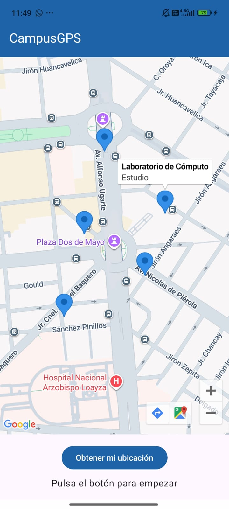
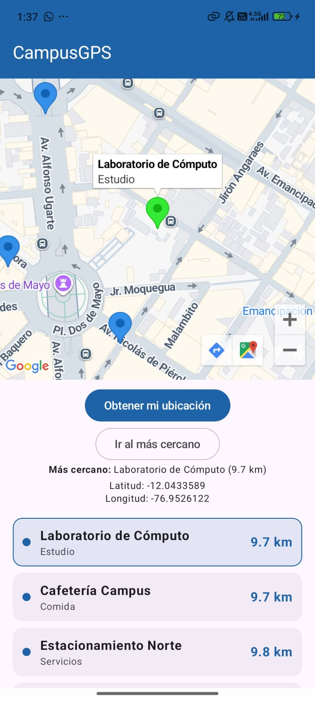
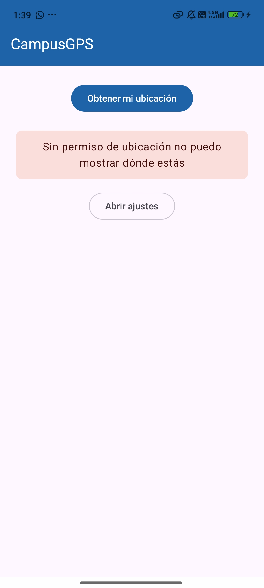
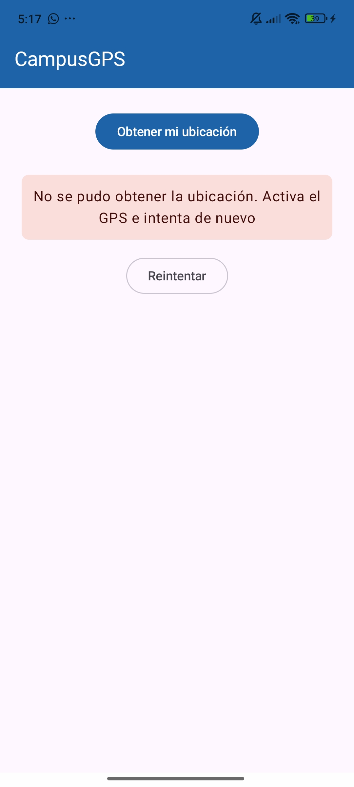

# CampusGPS

**Alumna:** Daniela Fransua Vila Ramos
**Laboratorio 13:** Localización Geográfica

## Descripción

CampusGPS es una app Android que obtiene la ubicación del celular, la muestra en un mapa y te dice qué lugar del campus tienes más cerca. Muestra cinco puntos ficticios (biblioteca, cafetería, laboratorio, auditorio y estacionamiento) con su distancia en metros, ordenados del más cercano al más lejano. El más cercano se marca en verde y se puede ir a él con un botón.

La app sigue funcionando aunque el usuario niegue el permiso, apague el GPS o no tenga Google Play Services: en cada caso muestra un mensaje claro y una acción útil.

**Tecnología:** Kotlin + Jetpack Compose + Material 3 (sin XML), Google Play Services Location (`FusedLocationProviderClient`), Maps Compose.
**Patrón:** MVVM + Repository (interface).

## Estructura de paquetes

```
com.vila.campusgps/
├── MainActivity.kt
├── model/
│   └── Modelos.kt                    Posicion, Lugar, LugarConDistancia, UbicacionUi, TipoError
├── data/
│   ├── UbicacionRepository.kt        interface (+ UbicacionNoDisponibleException)
│   ├── UbicacionRepositoryGoogle.kt  implementación con FusedLocationProviderClient
│   ├── LugaresRepository.kt          interface
│   └── LugaresRepositoryLocal.kt     los 5 lugares ficticios
├── util/
│   ├── Distancia.kt                  distanciaMetros()
│   └── Formato.kt                    formatearDistancia()
├── viewmodel/
│   ├── MapaViewModel.kt
│   └── CampusViewModelFactory.kt
└── ui/
    ├── PantallaMapa.kt
    ├── MapaUbicacion.kt
    ├── ListaLugares.kt
    ├── MensajeError.kt
    └── theme/
```

## Arquitectura MVVM + Repository

```
View (PantallaMapa)
   |  evento: pulsar el botón        ^  collectAsState()
   v                                 |
ViewModel (MapaViewModel)  --- StateFlow --->
   |  llama a las interfaces
   v
UbicacionRepository  ---> UbicacionRepositoryGoogle (FusedLocationProviderClient)
LugaresRepository    ---> LugaresRepositoryLocal (los 5 lugares fijos)
```

| Capa | Conoce a | No hace |
|---|---|---|
| View (`ui/`) | Solo a su ViewModel | No usa Repository ni `FusedLocationProviderClient`, no calcula distancias |
| ViewModel | Solo a las interfaces de Repository | No conoce Composables ni recibe un `Context` |
| Repository | Google Play Services (en la implementación) | No expone clases de UI |
| `util/` | Funciones puras (distancia, formato) | No guarda estado |

## Capturas

| Permiso | Mapa con mi ubicación | Marcadores |
|---|---|---|
|  |  |  |

| Lista ordenada | Error: permiso denegado | Error: GPS apagado |
|---|---|---|
|  |  |  |
## Pruebas de aceptación

| Prueba | Resultado esperado | OK |
|---|---|---|
| Abrir la app por primera vez y pulsar el botón | Aparece el cuadro de permiso | Sí |
| Aceptar el permiso | Se ven latitud, longitud y el marcador **Estás aquí** | Sí |
| Negar el permiso | Mensaje de error con **Abrir ajustes**, la app no se cierra | Sí |
| Ubicación en el punto base | Los 5 marcadores azules aparecen cerca de la posición | Sí |
| Tocar un marcador | Se ve el nombre y la categoría del lugar | Sí |
| Lista de lugares | Ordenada de menor a mayor distancia, con m o km | Sí |
| Tocar una tarjeta de la lista | La cámara viaja a ese lugar y la tarjeta queda resaltada | Sí |
| Ir al más cercano | La cámara va al lugar verde; el botón está deshabilitado antes de buscar | Sí |
| Cambiar la ubicación y buscar otra vez | Las distancias, el orden y el lugar verde se actualizan | Sí |
| Ubicación apagada | Mensaje de GPS con **Reintentar** | Sí |
| Rotar la pantalla | No se pierden la ubicación ni la lista | Sí |
| Revisar el repositorio | `git grep` no encuentra la clave y `local.properties` no está subido | Sí |

## Configuración de la clave de Maps

La clave de API **no está en el repositorio**. Para ejecutar el proyecto:

1. Crear una clave en Google Cloud con **Maps SDK for Android** habilitado, restringida al paquete `com.vila.campusgps` y a la huella SHA-1 del equipo (`./gradlew signingReport`).
2. Agregarla en `local.properties` (archivo que está en `.gitignore`):
   ```properties
   MAPS_API_KEY=mi_clave
   ```
3. `app/build.gradle.kts` la lee y la pasa al Manifest con `manifestPlaceholders["MAPS_API_KEY"]`, y el `<meta-data android:name="com.google.android.geo.API_KEY">` la usa.

## Para pensar

**1. ¿Por qué `FusedLocationProviderClient` está dentro del Repository y no en el ViewModel?**
Porque es un detalle de Google Play Services y necesita un `Context`. Si estuviera en el ViewModel, este dependería de Android y no se podría probar ni cambiar fácilmente. El ViewModel solo conoce la interface `UbicacionRepository` y le pide una `Posicion`; no le importa de dónde sale. Así se podría cambiar la implementación (por ejemplo, una falsa para pruebas) sin tocar el ViewModel.

**2. ¿Qué diferencia hay entre el permiso de ubicación y la clave de API de Maps? ¿Qué pasa si falta cada uno?**
El **permiso** lo da el **usuario** en su celular y permite que la app lea dónde está el dispositivo. La **clave de API** la da **Google** al desarrollador y permite que la app use el servicio de mapas.
- Sin permiso: el mapa se ve, pero la app no puede saber dónde estás. Muestra "Sin permiso de ubicación…" con el botón **Abrir ajustes**.
- Sin clave (o clave mal configurada o sin facturación): la ubicación sí funciona (latitud y longitud), pero el mapa sale gris o vacío y en Logcat aparece `Authorization failure`.

**3. ¿Por qué la clave va en `local.properties` y no en el código? ¿Qué harías si se subiera a GitHub por error?**
Porque `local.properties` está en `.gitignore` y no se sube al repositorio. Si la clave estuviera en el código o en el Manifest, cualquiera que vea el repositorio podría copiarla y usarla a nuestro nombre, gastando la cuota o el saldo de la cuenta.
Si se subiera por error: entraría a Google Cloud, **borraría esa clave (o la regeneraría)** y crearía una nueva, porque la anterior ya no es segura aunque la quite del repositorio (queda en el historial de Git). Luego pondría la nueva solo en `local.properties`.

**4. ¿Dónde calculas la distancia y por qué no en el Composable?**
En el **ViewModel**, dentro de `actualizarDistancias()`, usando la función pura `distanciaMetros()` de `util/Distancia.kt` (que usa `Location.distanceBetween`). Se llama solo cuando llega la ubicación en `buscar()`. No se hace en el Composable porque la pantalla solo debe **dibujar según el estado**: si calculara, rompería MVVM, repetiría el cálculo en cada recomposición y la lógica no se podría probar por separado.

**5. ¿Qué pasa con tu app si el usuario niega el permiso dos veces? ¿Cómo lo manejas?**
Desde Android 11, si el usuario niega el permiso dos veces, Android **ya no vuelve a mostrar el cuadro**: el lanzador responde de inmediato que el permiso fue negado. En mi app, ese resultado llama a `vm.permisoDenegado()`, la app **no se cierra** y muestra el mensaje con el botón **Abrir ajustes**. Ese botón abre la pantalla de ajustes de CampusGPS (`Settings.ACTION_APPLICATION_DETAILS_SETTINGS`), donde el usuario puede dar el permiso a mano.
