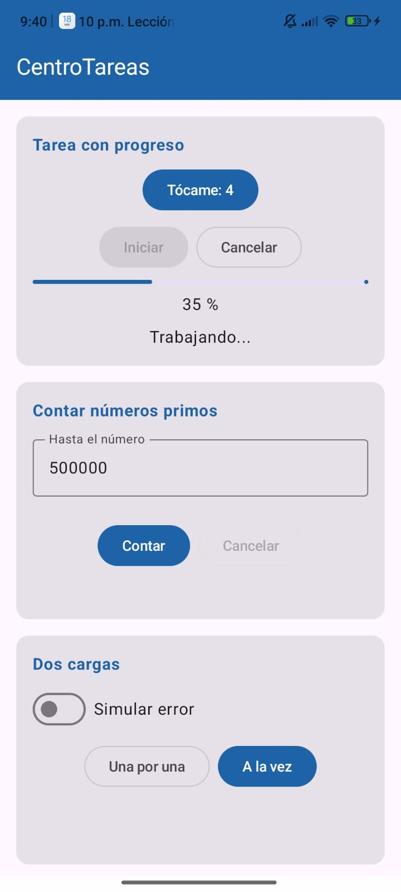
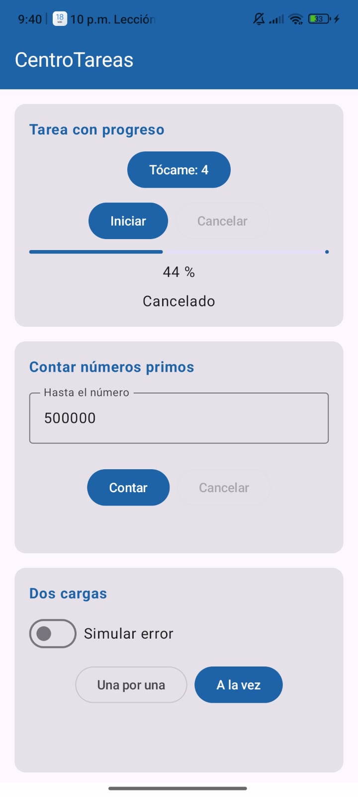
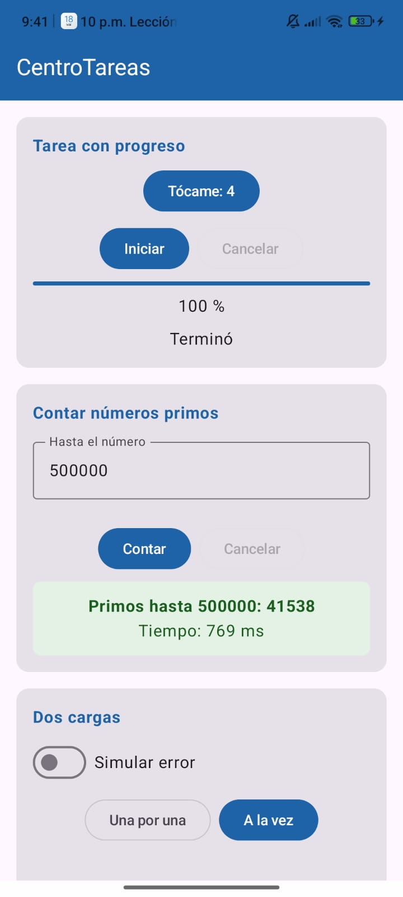
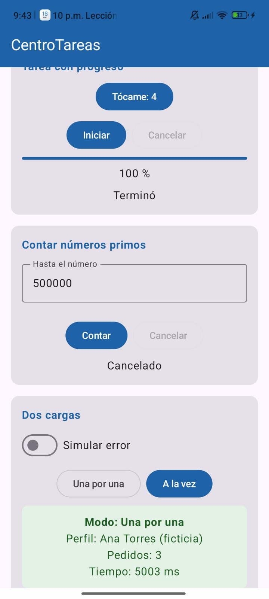
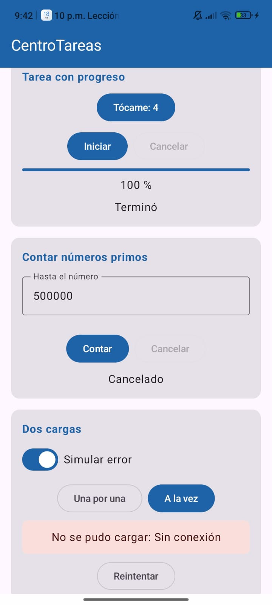
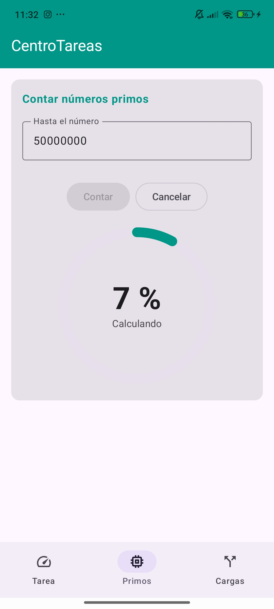
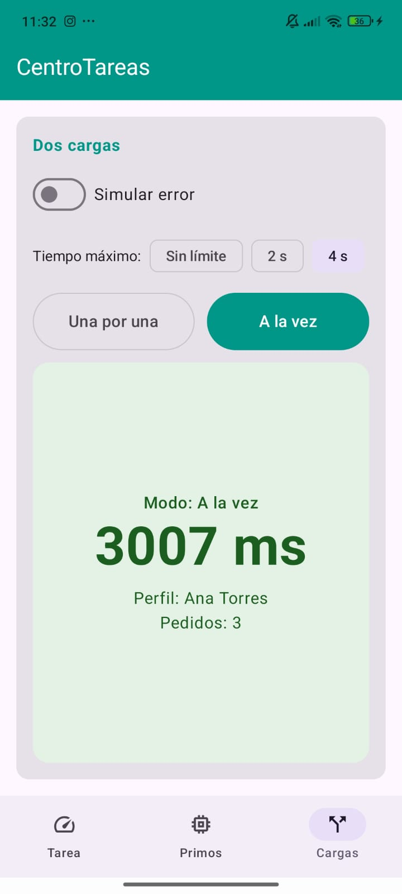
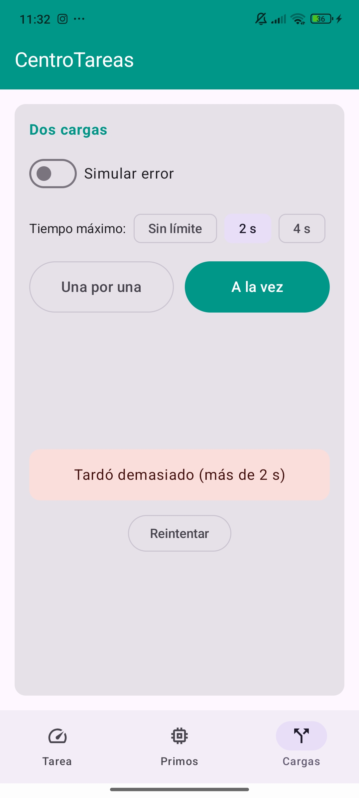

# CentroTareas

**Alumna:** Daniela Fransua Vila Ramos

**Laboratorio 14:** Hilos en Android

## Descripción

CentroTareas es una app Android que hace tres cosas que tardan, sin congelar nunca la pantalla:

1. **Tarea con progreso:** una tarea de unos 4 segundos con barra de progreso, que se puede cancelar.
2. **Contar números primos:** un cálculo pesado que usa mucho procesador, en segundo plano y cancelable.
3. **Dos cargas:** carga un perfil y unos pedidos simulados, una por una o a la vez, y compara los tiempos. También simula un error de conexión con un botón para reintentar.

El botón **Tócame** cuenta los toques y sirve como prueba de vida: si deja de sumar, la pantalla está congelada.

Primero se muestra el problema (bloquear el hilo principal con `Thread.sleep`) y después se resuelve con **corrutinas**: `viewModelScope`, `withContext`, `Job`, `async` y manejo de errores. Usa solo datos ficticios.

**Tecnología:** Kotlin + Jetpack Compose + Material 3 (sin XML), corrutinas y `ViewModel`.
**Patrón:** MVVM + Repository (interface).

## Estructura de paquetes

```
com.vila.centrotareas/
├── MainActivity.kt
├── model/
│   └── Estados.kt                  PrimosUi, CargaUi
├── data/
│   ├── TareasRepository.kt         interface
│   └── TareasRepositoryLocal.kt    cargas simuladas y contarPrimos
├── viewmodel/
│   ├── TareasViewModel.kt
│   └── TareasViewModelFactory.kt
└── ui/
    ├── PantallaTareas.kt           las tres tarjetas y la barra de navegación
    └── theme/

res/drawable/
├── ic_tarea.xml                    íconos de la barra de navegación (Fase 2)
├── ic_primos.xml
└── ic_cargas.xml
```

## Arquitectura MVVM + Repository

```
View (PantallaTareas)
   |  eventos: botones              ^  collectAsState()
   v                                |
ViewModel (TareasViewModel)  --- StateFlow --->
   |  viewModelScope.launch { ... }
   v
TareasRepository (interface)  --->  TareasRepositoryLocal
                                    (cargas simuladas y contar primos)
```

| Capa | Conoce a | No hace |
|---|---|---|
| View (`ui/`) | Solo a su ViewModel | No lanza corrutinas ni usa `Thread`; solo muestra el estado y avisa los eventos |
| ViewModel | Solo a la interface del Repository | No conoce Composables, no recibe un `Context` y no bloquea el hilo principal |
| Repository | Nada de la UI | No expone estados de pantalla; sus funciones `suspend` no bloquean el hilo desde el que se llaman |

## Observación del Paso 1

**Qué pasa con la pantalla:** al tocar **Tarea larga (MAL)** y enseguida **Tócame**, durante unos 4 segundos nada responde: el contador no sube, los botones no reaccionan y la pantalla se queda congelada. Después de los 4 segundos aparece directamente **Terminó** y recién ahí se cuentan los toques.

**Por qué no se ve "Trabajando...":** `tareaLargaMala()` corre en el **hilo principal**, que es el mismo que dibuja la pantalla. El código cambia el mensaje a "Trabajando...", pero `Thread.sleep(4000)` bloquea ese hilo, así que no puede redibujar. Cuando el hilo se libera, el mensaje ya cambió a "Terminó", y solo se dibuja ese último valor.

**Si la espera fuera de más de 10 segundos:** Android detecta que la app no responde (después de unos 5 segundos sin atender un toque) y muestra el cuadro **"La aplicación no responde" (ANR)**, con las opciones de esperar o cerrar la app.

## Capturas

| Tarea con progreso | Tarea cancelada | Contar primos |
|---|---|---|
|  |  |  |

| Una por una | A la vez | Error simulado |
|---|---|---|
|  |  |  |

## Pruebas de aceptación

| Prueba | Resultado esperado | OK |
|---|---|---|
| Tarea larga: tocar **Tócame** mientras trabaja | El contador sigue sumando | Sí |
| Logcat con filtro `HILO` | `main` antes y después; `DefaultDispatcher-worker` dentro | Sí |
| Iniciar la tarea con progreso | La barra avanza de 0 a 100 % en unos 4 s | Sí |
| Cancelar a mitad | La barra se detiene, dice **Cancelado** y se puede iniciar otra vez | Sí |
| Pulsar **Iniciar** dos veces seguidas | No se lanzan dos tareas (el botón está deshabilitado) | Sí |
| Primos hasta 1000 | Resultado **168** | Sí |
| Primos con N grande | La pantalla no se congela y **Cancelar** funciona | Sí |
| Una por una | Unos 5 s y resultado correcto | Sí |
| A la vez | Unos 3 s y resultado correcto | Sí |
| Error simulado + **Reintentar** | Recuadro rojo; al desactivar el interruptor y reintentar, éxito | Sí |
| Rotar la pantalla durante la tarea | La tarea continúa y el progreso no se reinicia | Sí |
| Revisar el código | `git grep` no encuentra `GlobalScope`, `runBlocking` ni `Thread.sleep` en el código final | Sí |

## Fase 2 · Mejoras con IA (rama `con-ia`)

Mejoras hechas con ayuda de IA (Claude), revisadas y probadas por mí, sin romper MVVM + Repository ni las reglas del laboratorio (sin `GlobalScope`, `runBlocking` ni `Thread.sleep`, y relanzando siempre la `CancellationException`). El detalle de los prompts y de lo que cambié está en [`PROMPTS.md`](PROMPTS.md).

| # | Mejora | Qué hace | Capas que cambian |
|---|---|---|---|
| 1 | Primos con progreso | Muestra el porcentaje del cálculo de primos mientras avanza, en un círculo grande. Si se cancela, indica en qué porcentaje se quedó. | Repository + ViewModel + View |
| 2 | Tiempo máximo | Selector *Sin límite / 2 s / 4 s*. Con `withTimeout`, si una carga pasa el límite se corta y aparece **Tardó demasiado** con el botón Reintentar. | ViewModel + View |
| 3 | Barra de navegación inferior | Pestañas **Tarea · Primos · Cargas**: cada una muestra solo su tarjeta. La tarea con progreso también se ve en un círculo y la pestaña de cargas ocupa toda la pantalla. | View |

### Capturas de las mejoras

| Primos con progreso | Tiempo máximo | Barra de navegación |
|---|---|---|
|  |  |  |

### Cómo se respeta MVVM en las mejoras

- **Primos con progreso:** el Repository recibe una función `alAvanzar` y la llama más o menos cada 1 % del recorrido. El ViewModel guarda ese avance en el `StateFlow` `progresoPrimos` y la pantalla solo lo dibuja. `ensureActive()` sigue dentro del ciclo, así que Cancelar funciona igual.
- **Tiempo máximo:** el límite vive en el ViewModel (`limiteMs`). `withTimeout` lanza `TimeoutCancellationException`, que también es una `CancellationException`; por eso se atrapa **antes** del `catch` que relanza la cancelación. El límite se puso como opciones y no fijo en 2 s, porque las cargas tardan 3 s y 5 s y con 2 s ninguna pasaría nunca. Con 4 s se ve la diferencia: «A la vez» pasa y «Una por una» no.
- **Barra de navegación:** la pestaña elegida es un estado de la interfaz, así que vive en la pantalla con `rememberSaveable` (se mantiene al rotar) y no en el ViewModel. Si se inicia una tarea y se cambia de pestaña, la tarea **sigue corriendo**, porque su corrutina vive en `viewModelScope` y no en la tarjeta.

## Para pensar

**1. ¿Por qué no se veía "Trabajando..." en el Paso 1?**
Porque `Thread.sleep(4000)` bloqueaba el **hilo principal**, que es el único que dibuja la pantalla. El mensaje sí cambiaba a "Trabajando...", pero la pantalla no podía redibujarse mientras el hilo estaba dormido. Cuando se liberó, el mensaje ya era "Terminó", así que solo se vio ese.

**2. ¿Qué diferencia hay entre `Thread.sleep` y `delay`?**
`Thread.sleep` **bloquea el hilo completo**: mientras duerme, ese hilo no puede hacer nada más (si es el principal, la pantalla se congela). `delay` solo **suspende la corrutina**: el hilo queda libre para hacer otras cosas, como dibujar o atender toques, y la corrutina continúa cuando pasa el tiempo. Además, `delay` revisa la cancelación, así que una corrutina en `delay` se puede cancelar.

**3. ¿Por qué `Dispatchers.Default` para los primos y `Dispatchers.IO` para la red?**
Contar primos es trabajo de **CPU** (muchas cuentas), y `Dispatchers.Default` tiene tantos hilos como núcleos del procesador, pensado para cálculos. La red o el disco son trabajo de **espera** (el hilo casi no calcula, solo espera la respuesta), y `Dispatchers.IO` tiene muchos más hilos para que esas esperas no ocupen los del cálculo.

**4. ¿Qué pasaría con la corrutina si el usuario cierra la pantalla? ¿Qué papel cumple `viewModelScope`?**
`viewModelScope` ata las corrutinas a la vida del ViewModel. Si el usuario **rota** la pantalla, el ViewModel sobrevive y la tarea sigue (por eso el progreso no se reinicia). Si el usuario **cierra** la pantalla de verdad, el ViewModel se destruye y `viewModelScope` **cancela automáticamente** todas sus corrutinas. Así no quedan tareas trabajando en segundo plano ni se gasta batería o memoria. Con `GlobalScope` la tarea seguiría corriendo aunque nadie la necesite.

**5. ¿Por qué `async` tarda 3 s y no 5 s? ¿Qué pasa si una de las dos cargas falla?**
Porque con `async` las dos cargas corren **al mismo tiempo**: el perfil (2 s) y los pedidos (3 s) empiezan juntos, y solo se espera a la más lenta, así que el total es el máximo, unos 3 s. Una por una, se suman: 2 + 3 = 5 s.
Si una falla, `coroutineScope` **cancela la otra** y el error sale por `await()`. El `try/catch` lo atrapa y muestra "No se pudo cargar: Sin conexión" con el botón Reintentar. Así no queda una carga a medias.
