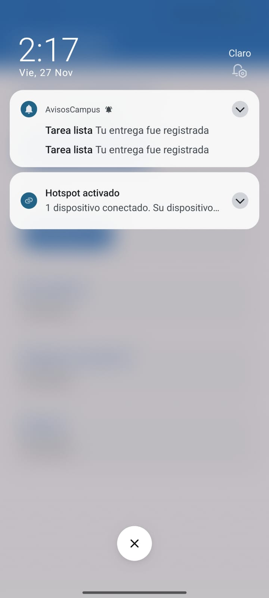
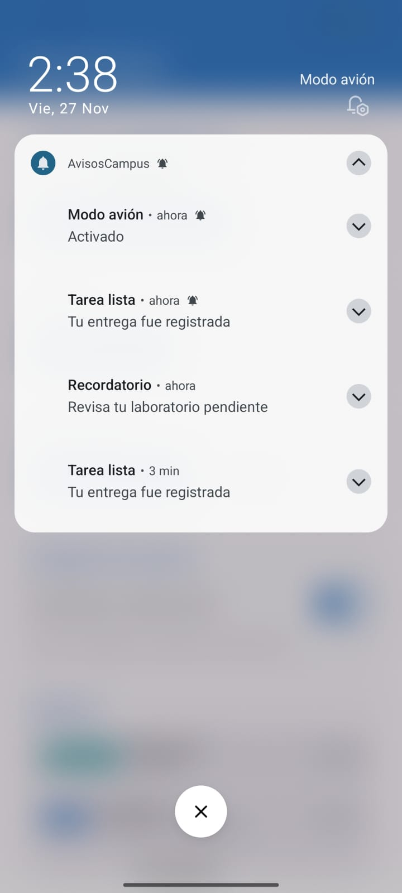
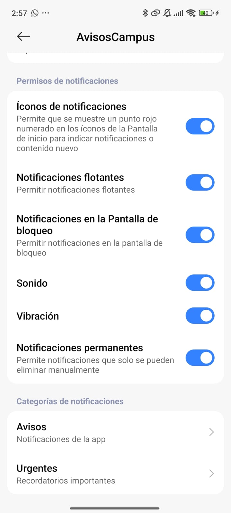
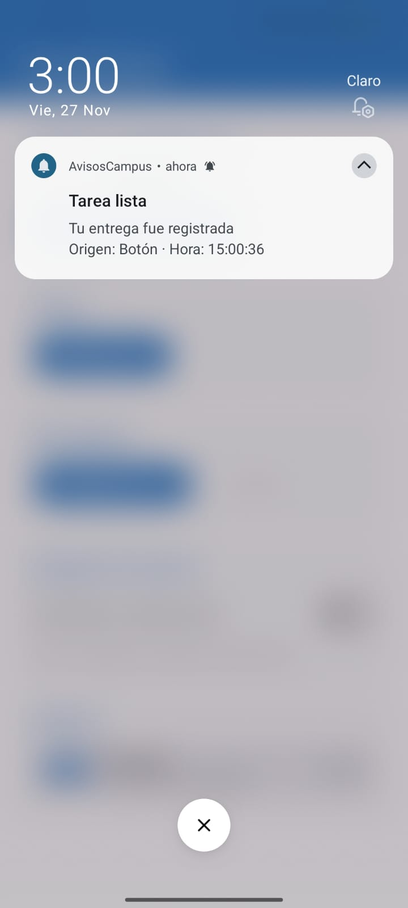
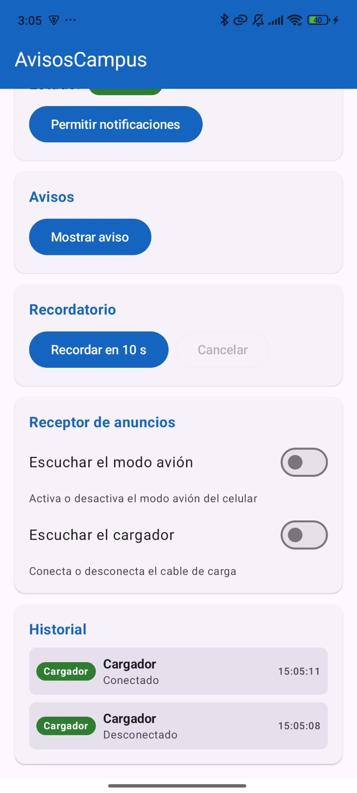
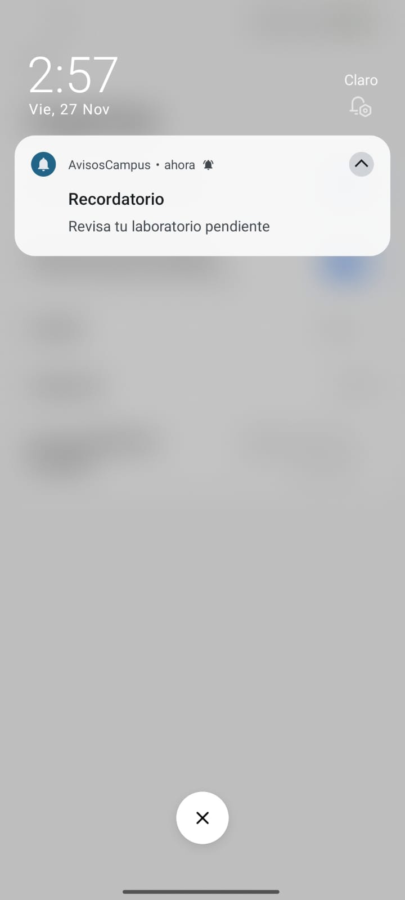

# AvisosCampus

**Laboratorio 15** · Programación en Móviles   
**Estudiante:** Daniela Fransua Vila Ramos

## Descripción

AvisosCampus es una app Android que muestra **notificaciones locales** del campus. Tiene tres fuentes de avisos:

- **Botón:** muestra al instante el aviso "Tarea lista".
- **Recordatorio:** cuenta regresiva de 10 segundos hecha con corrutinas. Se puede cancelar.
- **Receptor de anuncios:** un `BroadcastReceiver` que avisa cuando se activa o desactiva el modo avión.

Todos los avisos se guardan en un **historial**, se hayan mostrado o no. La app pide el permiso `POST_NOTIFICATIONS` (Android 13+), muestra su estado y, si el usuario lo niega, explica el problema y ofrece un botón para abrir los ajustes. Al tocar una notificación se abre la app.

## Tecnologías

- Kotlin
- Jetpack Compose + Material 3 (sin layouts XML)
- Arquitectura MVVM + Repository
- `ViewModel`, `StateFlow` y `SharedFlow`
- Corrutinas (`viewModelScope`, `delay`, `Job`)
- `NotificationChannel`, `NotificationCompat`, `NotificationManagerCompat` y `PendingIntent`
- `BroadcastReceiver` registrado en tiempo de ejecución (`ContextCompat.registerReceiver`)
- Activity Result API (`RequestPermission`)
- Min SDK 24, compile SDK 37

## Estructura de paquetes

```
com.vila.avisoscampus/
├── AvisosApp.kt                  Application: crea el canal "Avisos"
├── MainActivity.kt               Scaffold + TopAppBar + PantallaAvisos
├── model/
│   └── Modelos.kt                Aviso, Origen, PermisoUi
├── data/
│   └── AvisosRepository.kt       interface + AvisosRepositoryMemoria
├── notificacion/
│   └── Notificador.kt            canal, permiso y mostrar notificación
├── receiver/
│   └── ModoAvionReceiver.kt      escucha ACTION_AIRPLANE_MODE_CHANGED
├── viewmodel/
│   ├── AvisosViewModel.kt        decide qué avisar y emite eventos
│   └── AvisosViewModelFactory.kt
└── ui/
    ├── PantallaAvisos.kt         las 5 tarjetas
    ├── HistorialAvisos.kt        lista de avisos (sin ViewModel)
    └── theme/                    tema azul
```

## Arquitectura (MVVM)

```
 ┌──────────────────────────────────────────────┐
 │  View (ui/PantallaAvisos)                    │
 │  - Tiene Context (LocalContext)              │
 │  - Pide el permiso, registra el receptor     │
 │  - Recoge vm.eventos y llama a Notificador   │
 └───────┬──────────────────────▲───────────────┘
         │ acciones             │ StateFlow (estado)
         │ (avisarAhora,        │ SharedFlow<Aviso> (eventos)
         │  recordarEn, ...)    │
 ┌───────▼──────────────────────┴───────────────┐
 │  AvisosViewModel                             │
 │  - SIN Context, NotificationManager,         │
 │    BroadcastReceiver ni Composables          │
 │  - Decide qué avisar, lo registra y emite    │
 └───────┬──────────────────────────────────────┘
         │ registrar(...) / avisos
 ┌───────▼──────────────────────────────────────┐
 │  AvisosRepository (interface)                │
 │  └── AvisosRepositoryMemoria (sin Context)   │
 └──────────────────────────────────────────────┘

 View ──(Context, aviso)──▶ Notificador (object) ──▶ Sistema Android
```

**Flujo de un aviso:** el usuario pulsa un botón y la View llama al ViewModel. El ViewModel registra el aviso en el Repository y lo emite en `eventos`. La View lo recoge y llama a `Notificador.mostrar(context, aviso)`. Si `mostrar` devuelve `false` (no hay permiso), la View llama a `vm.noSePudoMostrar()`.

## Pruebas de aceptación

| N.º | Prueba | Resultado esperado | OK |
|-----|--------|--------------------|----|
| 1 | Abrir Ajustes > Apps > AvisosCampus > Notificaciones | Aparece el canal "Avisos" | Sí |
| 2 | Pulsar "Permitir notificaciones" y aceptar | Se ve el cuadro de Android y la etiqueta dice "Permitido" (verde) | Sí |
| 3 | Pulsar "Permitir notificaciones" y negar | La etiqueta dice "Denegado" (rojo) | Sí |
| 4 | Pulsar "Mostrar aviso" dos veces | Salen dos notificaciones distintas "Tarea lista" | Sí |
| 5 | Con la app cerrada, tocar la notificación | Se abre la app y la notificación desaparece | Sí |
| 6 | Pulsar "Recordar en 10 s" | La cuenta baja de 10 a 1 y llega "Recordatorio" | Sí |
| 7 | Iniciar el recordatorio y minimizar la app | La notificación llega igual | Sí |
| 8 | Iniciar el recordatorio y pulsar "Cancelar" | La cuenta se detiene y no llega ningún aviso | Sí |
| 9 | Switch activo y cambiar el modo avión | Sale "Modo avión: Activado" o "Desactivado" | Sí |
| 10 | Switch apagado y cambiar el modo avión | No sale ningún aviso | Sí |
| 11 | Rotar la pantalla con el Switch activo | Sigue escuchando el modo avión | Sí |
| 12 | Generar varios avisos | Aparecen arriba en el historial con su origen y hora | Sí |
| 13 | Rotar la pantalla | El historial se conserva | Sí |
| 14 | Con el permiso negado, pulsar "Mostrar aviso" | La app no se cierra, el aviso queda en el historial y aparece el mensaje de error | Sí |
| 15 | Pulsar "Abrir ajustes" | Se abre la pantalla de notificaciones de la app | Sí |

## Capturas

Las capturas están en la carpeta [`capturas/`](capturas/).

| Notificación | Recordatorio | Modo avión |
|--------------|--------------|------------|
|  |  |  |

| Historial | Permiso denegado |
|-----------|------------------|
|  |  |

## Para pensar

**1. ¿Por qué una notificación necesita un canal y un permiso? ¿Qué pasa si falta cada uno?**
El **canal** (Android 8+) agrupa las notificaciones por tipo y deja que el usuario controle la importancia, el sonido o la vibración de cada grupo desde Ajustes. Si falta el canal, Android 8+ descarta la notificación sin mostrarla y escribe un error en Logcat. El **permiso** `POST_NOTIFICATIONS` (Android 13+) protege al usuario de apps que envían notificaciones sin su consentimiento. Si falta, `notify()` no muestra nada, y por eso la app revisa el permiso antes de mostrar y avisa al usuario cuando no lo tiene.

**2. ¿Por qué el ViewModel emite un evento y no muestra la notificación él mismo?**
Para mostrar una notificación hace falta un `Context`, y el ViewModel vive más que la Activity: si guardara su Context, provocaría fugas de memoria al rotar o cerrar la pantalla. Además, sin dependencias de Android, el ViewModel se puede probar con pruebas unitarias simples. Por eso el ViewModel solo decide **qué** avisar, y la View, que sí tiene Context, decide **cómo** mostrarlo a través del `Notificador`.

**3. ¿Qué pasa si usas el mismo id en dos notificaciones?**
La segunda **reemplaza** a la primera, así que el usuario solo ve una. Sirve para actualizar una notificación existente, por ejemplo un progreso. En esta app cada aviso usa su propio `aviso.id`, por eso dos pulsaciones generan dos notificaciones distintas.

**4. ¿Por qué onReceive debe ser corto y por qué hay que quitar el receptor al salir?**
`onReceive` corre en el hilo principal. Si tarda (unos 10 segundos), Android muestra un error "La app no responde" (ANR) y puede cerrarla. Por eso solo lee el dato y se lo pasa al ViewModel. El receptor se quita con `unregisterReceiver` en `onDispose` porque, si queda registrado, sigue recibiendo anuncios después de salir de la pantalla. Eso fuga memoria (retiene la pantalla vieja), gasta batería y puede duplicar avisos al volver a registrarlo.

**5. ¿En qué casos usarías una notificación local y en cuáles una push de Firebase?**
La **local** sirve cuando el aviso nace en el mismo celular: un recordatorio, un temporizador, un cambio del sistema como el modo avión, o el fin de una descarga. No necesita internet ni servidor. La **push de Firebase (FCM)** sirve cuando el aviso nace en un servidor o en otra persona: un mensaje de chat, una nota publicada por el docente o un anuncio para todos los alumnos. Llega aunque la app esté cerrada y no haya hecho nada.

---

# Fase 2 · Mejoras con IA

Rama: `con-ia` · Registro de prompts: [PROMPTS.md](PROMPTS.md)

En esta fase se agregaron 3 mejoras con ayuda de IA, sin romper la arquitectura MVVM + Repository: el ViewModel sigue sin `Context`, `NotificationManager` ni `BroadcastReceiver`.

| N | Mejora | Capas que cambian | Commit |
|---|--------|-------------------|--------|
| 1 | Dos canales: Urgentes y Avisos | Model, Notificador, ViewModel | `feat(canales): agrega canal Urgentes para el recordatorio` |
| 2 | Texto largo con BigTextStyle | Notificador | `feat(notificacion): muestra texto largo con BigTextStyle` |
| 3 | Receptor del cargador | Model, Receiver, ViewModel, UI | `feat(receptor): escucha el cargador con su propio switch` |

## Capturas de la Fase 2

| Mejora 1 · Canales | Mejora 2 · Texto largo | Mejora 3 · Cargador |
|--------------------|------------------------|---------------------|
|  |  |  |
| Ajustes de la app con los dos canales: "Avisos" y "Urgentes" | Notificación expandida con el texto, el origen y la hora | Aviso "Cargador" con su etiqueta verde en el historial |
|  | | |
| El recordatorio aparece como notificación emergente arriba de la pantalla | | |

## Cómo funciona cada mejora

**Mejora 1 · Dos canales (Urgentes y Avisos).**
`Aviso` tiene un campo nuevo, `urgente: Boolean = false`. El valor por defecto evita romper el código que ya existía. El **ViewModel** decide qué es urgente: al terminar el recordatorio emite `aviso.copy(urgente = true)`. El **Notificador** crea dos canales, `avisos` (IMPORTANCE_DEFAULT) y `urgentes` (IMPORTANCE_HIGH), y solo elige el canal y la prioridad según `aviso.urgente`. Como la importancia de un canal no se puede cambiar después de creado, hay que desinstalar la app para que el canal nuevo se cree bien.
*Capas: Model, Notificador, ViewModel.*

**Mejora 2 · Texto largo con BigTextStyle.**
La notificación cerrada sigue mostrando el texto corto (`setContentText`). Al expandirla, `NotificationCompat.BigTextStyle()` muestra el texto completo y una segunda línea con `Origen: … · Hora: …`.
*Capa: solo el Notificador. El ViewModel no cambia, porque el formato visual es un detalle de Android.*

**Mejora 3 · Receptor del cargador.**
`CargadorReceiver` escucha `ACTION_POWER_CONNECTED` y `ACTION_POWER_DISCONNECTED`. Su `onReceive` es corto: solo llama a `alCambiar(true/false)`. La pantalla tiene un segundo Switch, "Escuchar el cargador", y un `DisposableEffect` **propio** que registra el receptor con `RECEIVER_NOT_EXPORTED` y lo quita en `onDispose`. El ViewModel guarda el estado del switch y registra el aviso con el nuevo origen `CARGADOR`, que en el historial aparece con una etiqueta verde.
*Capas: Model, Receiver, ViewModel, UI (pantalla e historial).*

## Pruebas de la Fase 2

| Prueba | Cómo se hizo | Resultado | OK |
|--------|--------------|-----------|----|
| Existen los dos canales | Desinstalar, reinstalar y abrir Ajustes > Apps > AvisosCampus > Notificaciones | Aparecen "Avisos" y "Urgentes" | Sí |
| El recordatorio es urgente | Pulsar "Recordar en 10 s" e ir a la pantalla de inicio | La notificación aparece emergente arriba | Sí |
| "Mostrar aviso" sigue normal | Pulsar "Mostrar aviso" | Sale en la cortina, sin emerger | Sí |
| Texto corto al estar cerrada | Pulsar "Mostrar aviso" y bajar la cortina | Se ve solo "Tu entrega fue registrada" | Sí |
| Texto largo al expandir | Deslizar hacia abajo sobre la notificación | Se ve el texto, el origen y la hora | Sí |
| Cargador conectado | Activar "Escuchar el cargador" y conectar el cable | Sale "Cargador - Conectado" | Sí |
| Cargador desconectado | Con el switch activo, desconectar el cable | Sale "Cargador - Desconectado" | Sí |
| Switch del cargador apagado | Apagar el switch y conectar o desconectar el cable | No sale ningún aviso | Sí |
| Switches independientes | Activar solo uno de los dos switches y probar ambos eventos | Solo avisa el receptor activo | Sí |
| Etiqueta en el historial | Revisar el historial después de usar el cargador | Los avisos muestran la etiqueta "Cargador" | Sí |
