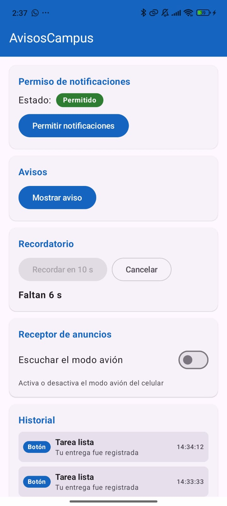
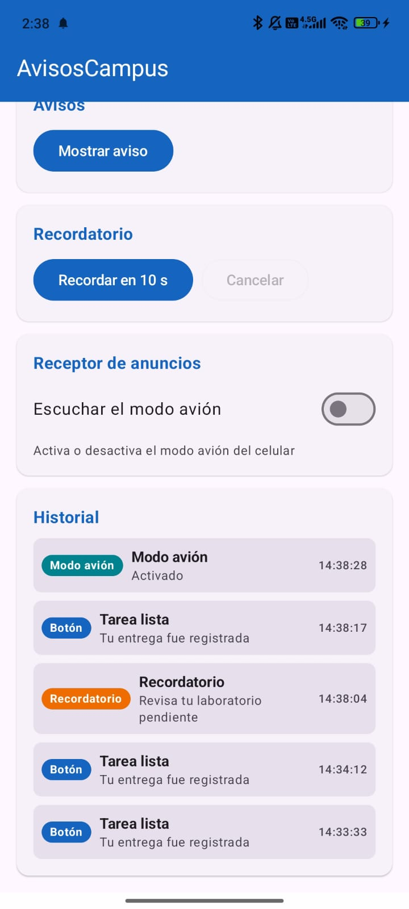
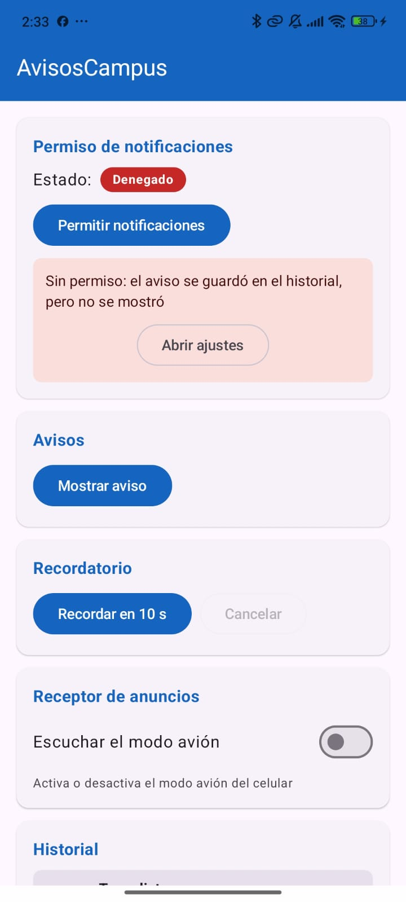

# AvisosCampus

**Laboratorio 15** · Programación en Móviles   
**Estudiante:** Daniela Fransua Vila Ramos

## Descripción

AvisosCampus es una app Android que muestra **notificaciones locales** del campus. Tiene tres fuentes de avisos:

- **Botón:** muestra al instante el aviso "Tarea lista".
- **Recordatorio:** cuenta regresiva de 10 segundos hecha con corrutinas. Se puede cancelar.
- **Receptor de anuncios:** un `BroadcastReceiver` que avisa cuando se activa o desactiva el modo avión.

Todos los avisos se guardan en un **historial**, se hayan mostrado o no. La app pide el permiso `POST_NOTIFICATIONS` (Android 13+), muestra su estado y, si el usuario lo niega, explica el problema y ofrece un botón para abrir los ajustes. Al tocar una notificación se abre la app.

## Tecnologías

- Kotlin
- Jetpack Compose + Material 3 (sin layouts XML)
- Arquitectura MVVM + Repository
- `ViewModel`, `StateFlow` y `SharedFlow`
- Corrutinas (`viewModelScope`, `delay`, `Job`)
- `NotificationChannel`, `NotificationCompat`, `NotificationManagerCompat` y `PendingIntent`
- `BroadcastReceiver` registrado en tiempo de ejecución (`ContextCompat.registerReceiver`)
- Activity Result API (`RequestPermission`)
- Min SDK 24, compile SDK 37

## Estructura de paquetes

```
com.vila.avisoscampus/
├── AvisosApp.kt                  Application: crea el canal "Avisos"
├── MainActivity.kt               Scaffold + TopAppBar + PantallaAvisos
├── model/
│   └── Modelos.kt                Aviso, Origen, PermisoUi
├── data/
│   └── AvisosRepository.kt       interface + AvisosRepositoryMemoria
├── notificacion/
│   └── Notificador.kt            canal, permiso y mostrar notificación
├── receiver/
│   └── ModoAvionReceiver.kt      escucha ACTION_AIRPLANE_MODE_CHANGED
├── viewmodel/
│   ├── AvisosViewModel.kt        decide qué avisar y emite eventos
│   └── AvisosViewModelFactory.kt
└── ui/
    ├── PantallaAvisos.kt         las 5 tarjetas
    ├── HistorialAvisos.kt        lista de avisos (sin ViewModel)
    └── theme/                    tema azul
```

## Arquitectura (MVVM)

```
 ┌──────────────────────────────────────────────┐
 │  View (ui/PantallaAvisos)                    │
 │  - Tiene Context (LocalContext)              │
 │  - Pide el permiso, registra el receptor     │
 │  - Recoge vm.eventos y llama a Notificador   │
 └───────┬──────────────────────▲───────────────┘
         │ acciones             │ StateFlow (estado)
         │ (avisarAhora,        │ SharedFlow<Aviso> (eventos)
         │  recordarEn, ...)    │
 ┌───────▼──────────────────────┴───────────────┐
 │  AvisosViewModel                             │
 │  - SIN Context, NotificationManager,         │
 │    BroadcastReceiver ni Composables          │
 │  - Decide qué avisar, lo registra y emite    │
 └───────┬──────────────────────────────────────┘
         │ registrar(...) / avisos
 ┌───────▼──────────────────────────────────────┐
 │  AvisosRepository (interface)                │
 │  └── AvisosRepositoryMemoria (sin Context)   │
 └──────────────────────────────────────────────┘

 View ──(Context, aviso)──▶ Notificador (object) ──▶ Sistema Android
```

**Flujo de un aviso:** el usuario pulsa un botón y la View llama al ViewModel. El ViewModel registra el aviso en el Repository y lo emite en `eventos`. La View lo recoge y llama a `Notificador.mostrar(context, aviso)`. Si `mostrar` devuelve `false` (no hay permiso), la View llama a `vm.noSePudoMostrar()`.

## Pruebas de aceptación

| N.º | Prueba | Resultado esperado | OK |
|-----|--------|--------------------|----|
| 1 | Abrir Ajustes > Apps > AvisosCampus > Notificaciones | Aparece el canal "Avisos" | Sí |
| 2 | Pulsar "Permitir notificaciones" y aceptar | Se ve el cuadro de Android y la etiqueta dice "Permitido" (verde) | Sí |
| 3 | Pulsar "Permitir notificaciones" y negar | La etiqueta dice "Denegado" (rojo) | Sí |
| 4 | Pulsar "Mostrar aviso" dos veces | Salen dos notificaciones distintas "Tarea lista" | Sí |
| 5 | Con la app cerrada, tocar la notificación | Se abre la app y la notificación desaparece | Sí |
| 6 | Pulsar "Recordar en 10 s" | La cuenta baja de 10 a 1 y llega "Recordatorio" | Sí |
| 7 | Iniciar el recordatorio y minimizar la app | La notificación llega igual | Sí |
| 8 | Iniciar el recordatorio y pulsar "Cancelar" | La cuenta se detiene y no llega ningún aviso | Sí |
| 9 | Switch activo y cambiar el modo avión | Sale "Modo avión: Activado" o "Desactivado" | Sí |
| 10 | Switch apagado y cambiar el modo avión | No sale ningún aviso | Sí |
| 11 | Rotar la pantalla con el Switch activo | Sigue escuchando el modo avión | Sí |
| 12 | Generar varios avisos | Aparecen arriba en el historial con su origen y hora | Sí |
| 13 | Rotar la pantalla | El historial se conserva | Sí |
| 14 | Con el permiso negado, pulsar "Mostrar aviso" | La app no se cierra, el aviso queda en el historial y aparece el mensaje de error | Sí |
| 15 | Pulsar "Abrir ajustes" | Se abre la pantalla de notificaciones de la app | Sí |

## Capturas

Las capturas están en la carpeta [`capturas/`](capturas/).

| Notificación | Recordatorio | Modo avión |
|--------------|--------------|------------|
|  |  |  |

| Historial | Permiso denegado |
|-----------|------------------|
|  |  |

## Para pensar

**1. ¿Por qué una notificación necesita un canal y un permiso? ¿Qué pasa si falta cada uno?**
El **canal** (Android 8+) agrupa las notificaciones por tipo y deja que el usuario controle la importancia, el sonido o la vibración de cada grupo desde Ajustes. Si falta el canal, Android 8+ descarta la notificación sin mostrarla y escribe un error en Logcat. El **permiso** `POST_NOTIFICATIONS` (Android 13+) protege al usuario de apps que envían notificaciones sin su consentimiento. Si falta, `notify()` no muestra nada, y por eso la app revisa el permiso antes de mostrar y avisa al usuario cuando no lo tiene.

**2. ¿Por qué el ViewModel emite un evento y no muestra la notificación él mismo?**
Para mostrar una notificación hace falta un `Context`, y el ViewModel vive más que la Activity: si guardara su Context, provocaría fugas de memoria al rotar o cerrar la pantalla. Además, sin dependencias de Android, el ViewModel se puede probar con pruebas unitarias simples. Por eso el ViewModel solo decide **qué** avisar, y la View, que sí tiene Context, decide **cómo** mostrarlo a través del `Notificador`.

**3. ¿Qué pasa si usas el mismo id en dos notificaciones?**
La segunda **reemplaza** a la primera, así que el usuario solo ve una. Sirve para actualizar una notificación existente, por ejemplo un progreso. En esta app cada aviso usa su propio `aviso.id`, por eso dos pulsaciones generan dos notificaciones distintas.

**4. ¿Por qué onReceive debe ser corto y por qué hay que quitar el receptor al salir?**
`onReceive` corre en el hilo principal. Si tarda (unos 10 segundos), Android muestra un error "La app no responde" (ANR) y puede cerrarla. Por eso solo lee el dato y se lo pasa al ViewModel. El receptor se quita con `unregisterReceiver` en `onDispose` porque, si queda registrado, sigue recibiendo anuncios después de salir de la pantalla. Eso fuga memoria (retiene la pantalla vieja), gasta batería y puede duplicar avisos al volver a registrarlo.

**5. ¿En qué casos usarías una notificación local y en cuáles una push de Firebase?**
La **local** sirve cuando el aviso nace en el mismo celular: un recordatorio, un temporizador, un cambio del sistema como el modo avión, o el fin de una descarga. No necesita internet ni servidor. La **push de Firebase (FCM)** sirve cuando el aviso nace en un servidor o en otra persona: un mensaje de chat, una nota publicada por el docente o un anuncio para todos los alumnos. Llega aunque la app esté cerrada y no haya hecho nada.
